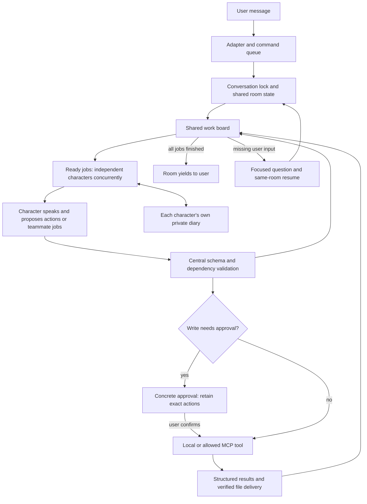

# Shared room architecture

The external account integrations use a separate [named bridge registry and WeChat account controller](WECHAT_BRIDGE.md).
The room can invoke its owner-gated tools. Enabled WeChat conversations reuse the agent loop and shared
registry with platform capabilities, bounded context, owner approvals for privileged operations and delivery restricted to
their current chat. A durable account whitelist gates all automatic replies; group assistants additionally
require an exact configured @mention. Notification subscriptions and owner reply routing are independent.
Their settings and histories remain separate from the room and its character diaries. The bridge parser
and both help entry points share one command catalogue; group names and aliases live in SQLite.

Agent mode uses one room loop for conversation and work. There is no initial chat/task classifier,
permanent task owner, or separate planner/reviewer. A character can respond, use registered tools,
or give a teammate a focused job. The room owns every outstanding job until completion, missing
input/approval, or a concrete blocker. A greeting uses the same loop with no work items.

Direct group address starts all four characters independently; their replies arrive in completion
order. Naming characters starts those voices. Otherwise the initial voice rotates across the room.
This selection answers who was addressed, not whether the message is chat or a task. There is at most
one active job per character; a slow character does not hold up independent teammates. Model calls
receive a snapshot of verified shared state, so they cannot pretend to have heard unfinished replies.

A character turn contains `status`, `message`, `actions`, `jobs`, and an optional `work_note`. The short message is delivered
before tools execute. A proposed job contains a unique `id`, `character`, `instruction`, and `after`
dependency IDs. For example, Luna can request Gemini's metrics and Claude's logs independently,
then a repair job after both, then verification after the repair. Each assignee speaks and chooses
her own next actions. Delegating completes the delegator's turn, while the room keeps going.
Characters may also invite a social response through the same board; no separate discussion loop
or mandatory final report is introduced.

| Component | Responsibility |
| --- | --- |
| `adapters/discord_adapter.py` | Access checks, DM resolution, live messages, file delivery, global command queue. |
| `features/feature_agent.py` | Room input preparation, providers, private diaries, tool adapter, live notes, history, pending sessions. |
| `services/shared_room.py` | Concurrent scheduling, dependency validation, shared observations, approvals, resumption, deduplication, bounded execution. |
| `services/room_prompt.py` | Common turn contract and conversation/work behavior for all characters. |
| `services/command_registry.py` | Exact argument validation and local/MCP dispatch. |
| `services/tool_outcome.py` | Success/failure/needs-input results, sources, retryability, actual artifact checks. |
| `services/mcp_tools.py` | Configured allowed remote capabilities and their risk classification. |
| `services/character_diary.py` | Separate selective private notes for each character and user. |
| `services/request_timing.py` | Queue, SDK attempts, token usage, tools, first delivery, and termination timing. |

Independent read operations can run concurrently. Identical in-flight reads share one execution.
Preparation and writes are serialized; an identical successful preparation/write is not executed or
delivered twice in the same room run. Writes still need central explicit approval of concrete arguments.
Independent jobs can finish while a write waits for approval. Confirmation executes retained actions
without asking a model to recreate them. A changed request invalidates unexecuted pending actions and
returns to the character for reconsideration. Tool batches stop at their first failed prerequisite.
A failed dependency blocks its downstream jobs; independent work can continue. A character cannot
claim completion immediately after her own failed tool. Identical non-retryable failures are not
executed again; transient read failures permit one retry.

The model receives an explicit tool-call envelope and examples: `{"tool":"system_status","arguments":"{}"}`.
On the wire, arguments are a JSON-encoded object string; the adapter decodes them before the registry
validates the tool's own schema. This lets arbitrary registered tools share one closed room schema.
Luna, Claude and Gemini use native structured output; DeepSeek and OpenRouter use JSON mode with
local validation. The setting is scoped to the current model call, including its worker thread, so
concurrent ordinary chat keeps its own format. Truncated JSON is rejected, never joined with a prose continuation.
A small adapter accepts equivalent `name`/`arguments` and function-call envelopes; it never drops unknown
fields or relaxes tool argument validation and write approval. A rejected turn gets a concrete correction.
Protocol rejections, job failures, and tool outcomes are logged as metadata without raw model responses
or argument contents. Internal schema errors are not displayed as the character's final answer.

`work_note` is a short public explanation in the character's voice and the user's language: relevant
facts, constraints, or the purpose of the next step. It is limited to 480 characters and sent before the
spoken update and tools. It is not private chain-of-thought or a transcript of internal deliberation.
It is generated in the same call as the turn, so visibility adds no separate summarizer call. Ordinary
chat can leave it empty. Public notes are saved with the exchange; private diary updates remain separate.
The structured response carries `diary_updates` inside the JSON. These are validated, assigned to the
actual character/user, and removed before the turn enters the shared board or public transcript.

Progress records observable actions and findings, not private reasoning. Long tools receive elapsed-time
updates and can report actual stages through `tool_progress`. Work notes stay visible; ordinary-chat
startup notes are removed. Each character receives recent dialogue, shared public board/results, and
only her own diary. Newly attached files are fetched once before the characters start, as common input
preparation for this same loop. Diarized personal facts are not copied to the shared board.

Defaults are 24 character model steps and 24 tool executions across the run and any resumes.
`AGENT_WORK_MAX_STEPS` and `AGENT_WORK_MAX_ACTIONS` adjust them. Exhausting a limit leaves work
unfinished. Initial turns use low effort; turns with tool results or dependencies use medium.
`AGENT_CONVERSATION_EFFORT` can override this. Calls have 35-second request timeouts, with native
transport retries disabled. A complete run can include several calls, so this is not a total latency guarantee.

Pending room state and approvals remain in memory and do not survive restart. Diaries, conversation
history, and attachment metadata are durable. Discord still has one global command worker, so separate
commands can queue behind an active exchange. Passive chat bypasses that queue, but the conversation
lock prevents simultaneous mutations to the same channel's history and room state.

The former planner, single-owner loop, and conversation helpers are retained for legacy paths.
Agent mode enters `SharedRoom` directly and does not call their router, full planner, progress reviewer,
or generated process-summary models. Tests label that retained coverage separately from the active room.
Model defaults and current prices are documented in [MODELS.md](MODELS.md).

## The video incident

On October 13 around 22:00 Los Angeles time, request `e1e85f47cead` had no queue wait,
but its first visible answer arrived after 17.98 seconds. DM progress and live replies
failed because `Client.get_channel()` couldn't resolve the incoming DM. The final
adapter send still worked because it had the native channel object. The adapter now
uses that same incoming channel for live delivery and can fetch uncached channels.

The extractor returned `No video formats found`. The saved answer incorrectly blamed
a missing time range and said a full video couldn't be downloaded. Later compression
and confirmation messages led back to the same extraction error. Tool handlers returned
error text rather than raising, and orchestration recorded those invocations as
`tool.succeeded`. Structured outcomes now preserve those errors as failures, including
`source_unavailable`; changing encoding settings doesn't resolve source access.

`download_video` is a capability that downloads the full duration by default and
chooses compression for the current upload limit. When an H.264/AAC source pair already
fits that limit and no explicit quality was requested, it is stream-copied instead of
re-encoded. `clip_video` remains a capability
for an explicitly requested preview. Download behavior belongs in the tool adapter,
not in the general execution loop. Blocking yt-dlp calls run in worker threads so they
don't freeze Discord's event loop. Video selection permits a combined format fallback.
Failed processing no longer ends with “All clips processed.”

The installed yt-dlp version was `2026.08.19`, matching the
[published stable release](https://github.com/yt-dlp/yt-dlp/releases/tag/2026.08.19)
at investigation time. A later metadata probe succeeded, so the earlier source failure
wasn't consistently reproducible. Local validation downloaded and encoded the same
public example to a full MP4 under the 10 MB limit. This verifies the local media path;
it doesn't guarantee the upstream extractor will always work or verify Discord upload.

## Server-management capability

The current built-in server tool reports host status. File inspection, shell execution,
service control, deployments, and Navidrome library operations require corresponding
tools to be registered, normally through an allowed MCP server. Once registered, the
same shared room loop can use them and inspect their results. The loop itself does not add
terminal or deployment access. It cannot finish work that requires an unavailable
capability, missing credential, or external service that remains inaccessible.

## October 14 action-format failure

At 10:38 Los Angeles time, the full-video request specifying 30 fps stopped after two model calls
and 11.1 seconds with zero tool executions. The saved reply exposed `each action must contain only
tool and arguments`. This was a protocol rejection before the downloader, not a new source-extraction
failure. The original malformed model output was not retained, so its exact field names are unknown.
The explicit envelope, safe normalization, and diagnostic events above address that boundary.
An isolated replay also caught plain-prose room turns from Luna; native output formatting removes
that source of repair calls. A subsequent four-provider check completed with no rejected turns.
A later replay reached Bilibili but received no downloadable formats, then spent time in a follow-up
search (108 seconds overall). Grounded search now has an explicit 25-second request timeout;
tool starts are logged separately from completions so in-flight delays can be located.

The downloader now exposes an optional `fps` argument and preserves it through encoding. It returns
full-duration, frame-rate, resolution, bitrate, size-estimate and upload-limit evidence to the room,
allowing a character to explain the actual settings. The rendered file still has to pass the existing
file-size and delivery checks; an estimate alone is not success.
The final isolated replay completed in 43.5 seconds (first model reply at 3.2 seconds), with one
download action and no rejected turns. `ffprobe` verified 120.767 seconds, 30 fps, and 8.55 MiB.
Delivery was simulated locally; the probe did not send a Discord message. The intermittent Bilibili
source-format failure remains possible and is reported separately from encoding or upload failures.

Provider format references: [OpenAI](https://developers.openai.com/api/docs/guides/structured-outputs),
[Claude](https://platform.claude.com/docs/en/build-with-claude/structured-outputs),
[Gemini](https://ai.google.dev/gemini-api/docs/generate-content/structured-output),
[DeepSeek](https://api-docs.deepseek.com/guides/json_mode/).

The WeChat bridge can read authenticated native SQLCipher/WAL snapshots through
`services/wechat_native.py` and `services/wechat_native_transport.py`. Native polling
runs independently of the desktop writer; exact native mention targets and message
IDs feed the same whitelist, conversation workers, tool registry and notification
routes. Delivery retains the account/recipient/draft checks and prepare/commit gate,
with native outgoing receipt correlation. See [WECHAT_BRIDGE.md](WECHAT_BRIDGE.md)
for the current data flow, private key setup and measured read latency.
