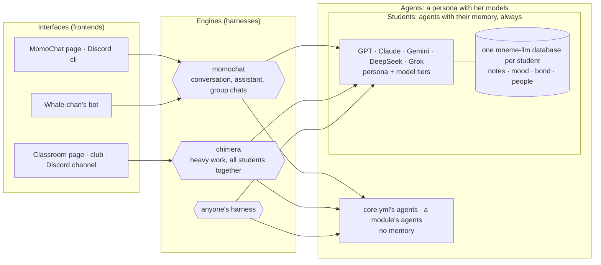

# Design: students, agents, harnesses and interfaces

These are the conclusions the owner and Claude reached on 2026-10-27, after a review of the whole project. Read them
before you change an engine, a student, an agent, the memory or the web UI. The detailed reasoning is in the project
notes (`DISCUSSION-2026-10-26.md`, sections 9g to 9j, outside this repository). Where the code does not match yet, the
**Status** column says so.

## Three layers

A student on her own is like having access to a model: it does nothing until something runs the conversation. That
something is a harness, which this project calls an **engine**. ChatGPT is a web page, a harness and a model. Here it
is an interface, an engine and a student (or an agent).

| Layer | Is | Lives in | Never |
| --- | --- | --- | --- |
| **Agent** | A persona (name, display name, prompt, pictures, other names, a one-line description) with her model profile: how people usually define an agent. She keeps no memory of anyone | core.yml `agents:` (its own), or any module's `Contributions.personas` (Chimera's own seats, WeChat's 本鲸) | Remember people |
| **Student** | A special agent: one of the five, with her memory, always (one mneme-llm database each: notes, mood, bond, people) and her model tiers (`own`, `strong`) | `extensions/students` (the folders and `memory.py`) | Exist without her memory: the module requires mneme-llm, so without it there are no students |
| **Engine** | A harness: what the speakers see, which tools they get, who speaks, when a turn ends | one module per engine | Know a platform; keep memory of people |
| **Interface** | A frontend: renders replies (her voice included), collects messages | one module per platform or page | Decide a reply |

**A student is a derived agent** (the owner's words: a derived class of Agent): everything an agent is, plus her
memory, and that is the only difference. So whatever takes an agent takes a student: MomoChat and Chimera ask only for
agents (personas), and a student brings her memory with her.

The memory and the models together are the students. Every engine reaches the same student, and with her the same
memory: what GPT knows of you in MomoChat she also knows in Chimera. Engines do not import mneme-llm: the students
module adds her memory through the core's hooks (a prompt part each turn, a watcher after each message, facts for the
pages). An agent is the plain case: anyone's harness can use one, and adding a model as an agent never needs
mneme-llm.

## The engines

| Engine | Product name | Job | Declares | Status |
| --- | --- | --- | --- | --- |
| `momochat` | **MomoChat** | The general assistant: conversations, direct and group chats, tools, commands. Speakers can pass each other tasks through a tool (`ask_classmate`: "search this for me", "draw this with image-2.5-Sunburst", "write this prompt"): the classmate answers after, and the asker finishes with it. With a student it is the companion experience; with an agent, a plain assistant | nothing (it takes whoever its assignment names) | **Built** (2026-10-27): the assistant, Whale-chan's chat engine and the room in one turn loop; their names are its former names |
| `chimera` | **Chimera**, shown as the Classroom | The heavy-work harness, used for real coding: routes, review, tests, two approvals. Where the students work together | `uses=("students",)`: its seats are the students, on their tiers; `team:` adds seats of its own | **Built** (2026-10-27): the workbench renamed; its seats come from the students |
| `terminal` | none | The creator's shell on the bot's machine. No model, not a student harness | nothing | Built, stays |

Rules for engines:

1. **One engine per job.** A new need goes into the engine that owns that job: a group chat is a MomoChat feature,
   not a new engine. Before adding an engine, say which job none of the existing ones does.
2. **MomoChat converses, Chimera works.** MomoChat does not plan multi-step work. A request bigger than a
   conversation goes to Chimera (`chimera.invite`).
3. **Engines keep no memory of people.** A student's memory is the students module's, the same in every engine; an
   agent has none. (No engine uses the core diary any more; the core still offers it.)
4. **Chimera reads the memory** (who you are) but does not learn from its own work reports.
5. **Anyone may bring a harness:** an engine module that declares what it needs. It can use agents without any
   memory, and students with theirs.
6. **Whether teamwork pays is Chimera's question.** It is answered by developing Chimera until it beats a single
   model reliably, with its outcomes log and the benchmark rounds as the evidence. MomoChat does not try routes.

## Interfaces and products

- The MomoChat page in the web UI, the Discord interface and the cli are frontends of `momochat`. Without MomoChat
  (or the students) the web UI still opens, greyed, and says why.
- **Whale-chan's bot** is one student, DeepSeek, reached through her own Discord bot: a frontend of `momochat` in its
  `full` style (a chat client: complete answers, one thread until `/new`), with its own extras (voice messages,
  speaking up). Her voice is the bot's: a rendering of her answer. It is an example plugin with its own purpose;
  the second Discord interface is by design.
- The Classroom page (`:4157`, the `classroom` interface), the `club` command and a Discord channel are frontends of
  `chimera`.
- An interface loses a tab when an engine is missing; it never stops the core.

## Declared dependencies

**Decided (Q1 to Q4 of the review). Status: built** (contracts 1.10); the details are in the module guide,
[EXTENSIONS.md](core/EXTENSIONS.md#dependencies).

- Every module declares, in its `Extension(...)`, the modules it `requires` (it is not loaded without them) and
  those it `uses` (a feature turns off without them), by module name. A Python package is `package:<name>`.
- Declaring is a must: the core checks every engine and persona a module's contributions name, and refuses a module
  that names something from a module it did not declare.
- A module whose `requires` are missing, or whose setup fails, is skipped with the reason; whatever requires it is
  skipped too. The core keeps running, and `--check` lists every skipped module and exits non-zero.
- A default a module suggests that names a missing `uses` is set aside with a warning. core.yml's own lines naming
  something missing stay fatal: the owner wrote them.

The chain today: `students` requires `package:mneme-llm>=0.2`; `whale_chan` requires `students` and `momochat`;
`webui` uses `momochat` and `students`; `chimera` uses `students`; `wechat` uses `momochat`.

## Former names

**Status: built** (contracts 1.11, [EXTENSIONS.md](core/EXTENSIONS.md#former-names)). A rename keeps what was under
the old name: `EngineSpec.formerly` (assignments naming the old engine reach it, its open runs carry on) and
`Extension.formerly` (a module takes over the data folder, settings, stores and facts of a name it had, or of a
module it took in; declarations naming the old name are given it). `Persona.formerly` did this for students since
1.9.

## The minimum core

**Status: built** (contracts 1.10). The core starts with no module at all. With one interface, the typed `$` commands
work (they never reach an engine): `$help`, `$runs`, `$approve`, `$deny`, `$cancel`, `$model`, `$memory`, `$tools`,
`$setup`, `$admin restart`, and `$call core.*`. The core's own default assignments (`*` and `routine:*`: MomoChat
with the core's `assistant` agent) apply only while their engine is loaded. A plain message with no engine gets one
line in the owner's direct chat, and silence elsewhere.

## Names

| Old | New | Status |
| --- | --- | --- |
| engines `assistant`, `chat`, `room`; modules `assistant`, `room` | engine and module `momochat` | **Built.** The old names are its former names: a core.yml line saying `engine: room` keeps working, with a warning |
| module and engine `workbench`; interface `workbench` | module and engine `chimera`; interface `classroom` | **Built.** Its data folder moves on the first start; the board keeps its file (`workbench.db`); its tasks are readdressed |
| module `companion` | part of `students` (`memory.py`) | **Built.** Its data folder, settings and facts are the students module's (`students.alias`, `students.bond`, ...) |
| core.yml `personas:` | core.yml `agents:` | **Built.** `personas:` is still read, merged under `agents:`; an agent may give her `models:` in the same entry |
| "the Classroom" | stays the page's name | |
