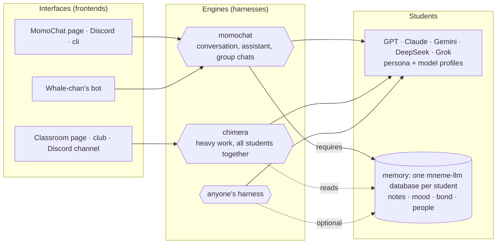

# Design: students, harnesses and interfaces

These are the conclusions the owner and Claude reached on 2026-10-27, after a review of the whole project. Read them
before you change an engine, a student, the memory or the web UI. The detailed reasoning is in the project notes
(`DISCUSSION-2026-10-26.md`, sections 9g to 9i, outside this repository). Where the code does not match yet, the
**Status** column says so.

## Three layers

A student on her own is like having access to a model: it does nothing until something runs the conversation. That
something is a harness, which this project calls an **engine**. ChatGPT is a web page, a harness and a model. Here it
is an interface, an engine and a student.

| Layer | Is | Lives in | Never |
| --- | --- | --- | --- |
| **Student** | A model with an identity: a persona (name, voice, prompts, pictures, aliases) and its model profiles | `extensions/students` | Decide how a conversation runs |
| **Memory** | What a student knows of people: one mneme-llm database per student, kept by the companion module through the core's hooks (watchers learn, prompt parts recall, facts publish bond and mood) | `extensions/companion` | Be required by a student: adding a model never needs mneme-llm |
| **Engine** | A harness: what the students see, which tools they get, who speaks, when a turn ends | one module per engine | Know a platform |
| **Interface** | A frontend: renders replies, collects messages | one module per platform or page | Decide a reply |

The memory and the models together are the students. Every engine reaches the same student and, if it wants, the
same memory: what GPT knows of you in MomoChat she also knows in Chimera. Engines do not import mneme-llm; they
declare the companion module and the core's hooks do the rest.

## The engines

| Engine | Product name | Job | Requires | Status |
| --- | --- | --- | --- | --- |
| `momochat` | **MomoChat** | The general assistant: conversations, direct and group chats, tools, commands. Students can pass each other tasks through tools ("search this for me", "draw this with image-2.5-Sunburst", "write this prompt"). | students, companion | **To build:** today three engines, `assistant` (the agent), `chat` (Whale-chan's plugin) and `room` (group chats with a work board) |
| `chimera` | **Chimera**, shown as the Classroom | The heavy-work harness, used for real coding: routes, review, tests, two approvals. Where the students work together. | students | **To build:** today the `workbench` engine, whose four seats are defined again inside it instead of coming from the students (it declares `uses` students for now) |
| `terminal` | none | The creator's shell on the bot's machine. No model, not a student harness. | nothing | Built, stays |

Rules for engines:

1. **One engine per job.** A new need goes into the engine that owns that job: a group chat is a MomoChat feature,
   not a new engine. Before adding an engine, say which job none of the existing ones does.
2. **MomoChat converses, Chimera works.** MomoChat does not plan multi-step work. A request bigger than a
   conversation goes to Chimera (`workbench.invite` today, `chimera.invite` after the rename).
3. **MomoChat is the companion experience**, so it requires the memory: without mneme-llm it is not loaded.
4. **Chimera reads the memory** (who you are) but does not learn from its own work reports.
5. **Anyone may bring a harness:** an engine module that declares what it needs. It can use the students without
   the memory.
6. **Whether teamwork pays is Chimera's question.** It is answered by developing Chimera until it beats a single
   model reliably, with its outcomes log and the benchmark rounds as the evidence. MomoChat does not try routes.

## Interfaces and products

- The MomoChat page in the web UI, the Discord interface and the cli are frontends of `momochat`.
- **Whale-chan's bot** is one student, DeepSeek, reached through her own Discord bot: a frontend of `momochat`
  that ships with its own extras (threads with `/new`, voice, speaking up). It is an example plugin with its own
  purpose; the second Discord interface is by design.
- The Classroom page (`:4157`), the `club` command and a Discord channel are frontends of `chimera`.
- An interface loses a tab when an engine is missing; it never stops the core.

## Declared dependencies

**Decided (Q1 to Q4 of the review). Status: built** (contracts 1.10); the details are in the module guide,
[EXTENSIONS.md](core/EXTENSIONS.md#dependencies).

- Every module declares, in its `Extension(...)`, the modules it `requires` (it is not loaded without them) and
  those it `uses` (a feature turns off without them), by module name. A Python package is `package:<name>`.
- Declaring is a must: the core checks every engine and persona a module's contributions name, and refuses a module
  that names something from a module it did not declare.
- A module whose `requires` are missing, or whose setup fails, is skipped with the reason; whatever requires it is
  skipped too. The core keeps running, and `--check` lists every skipped module and exits non-zero.
- A default a module suggests that names a missing `uses` is set aside with a warning. core.yml's own lines naming
  something missing stay fatal: the owner wrote them.

## The minimum core

**Status: built** (contracts 1.10). The core starts with no module at all. With one interface, the typed `$` commands work (they never reach an
engine): `$help`, `$runs`, `$approve`, `$deny`, `$cancel`, `$model`, `$memory`, `$tools`, `$setup`,
`$admin restart`, and `$call core.*`. The core's own default assignments (`*` and `routine:*`) apply only while
their engine is loaded. A plain message with no engine gets one line in the owner's direct chat, and silence
elsewhere.

## Names

| Old | New | Status |
| --- | --- | --- |
| engines `assistant`, `chat`, `room` | engine `momochat` | To build. The old names stay as the engine's former names: a core.yml line saying `engine: room` keeps working, with a warning |
| module and engine `workbench` | `chimera` | To build. Its data folder moves on the first start |
| "the Classroom" | stays the page's name | |
