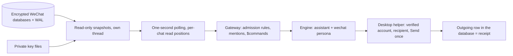

# WeChat

[`extensions/wechat`](../extensions/wechat/extension.py) connects one logged-in Linux WeChat account
(the native desktop client, checked with WeChat 4.1.13.26 on a Raspberry Pi 5, ARM64) to the core as
an interface. Which chats are answered, by which engine and persona, and with which tools is core
configuration; the interface only reads, sends and reports facts.

## How it works



* **Reading.** Contacts, sessions and messages are read from the account's encrypted local databases
  (SQLCipher 4 pages, committed WAL only) on a dedicated thread; live files are never opened writable.
  Only chats whose session row changed are read. Each chat's read position lives in the extension's
  bottle, so restarts neither lose nor replay messages; on the very first start existing messages count
  as history. `max_age_s` in the admission rules bounds how far back a catch-up answers.
* **Facts.** `is_direct`; `mentions_me` from WeChat's own mention list (typing "@name" by hand does not
  count); quotes become `reply_to` / `quoted_text`. A picked mention of the account is removed from the
  text, so `@bot $video …` works as a command. A burst of messages within `coalesce_seconds` lands in one
  run.
* **Images** are matched to their local `.dat` file, decrypted into the extension's data directory and
  recorded in history even without a mention, so "picture, then @bot what is this?" shows the picture
  with the question. Newer (V2) files need the image key (below); without it they stay `[Image]`.
  Usually only the thumbnail exists locally until someone opens the image.
* **Sending** goes through the desktop client (AT-SPI): the account and recipient are verified right
  before Send, a group reply quotes its trigger, and the outgoing database row is the receipt. An
  unverified send is never retried; the owner is told. Sends are spaced `account_interval_s` per account
  and `chat_interval_s` per chat (20 s each) without holding other chats up; owner sends are not spaced.
* **Manual replies.** A message typed on the phone or desktop is recorded and cancels the bot's open
  work in that chat.
* **Readiness.** Logged out, waiting for phone confirmation, client not running or another account:
  the interface reports not ready (deliveries wait) and the owner is told, also at startup. Signing out
  or switching accounts cancels open work.

## Setup

System packages (the desktop helper runs with the system Python):

```bash
sudo apt-get install at-spi2-core gir1.2-atspi-2.0 python3-pil xdotool grim libzstd1
```

The helper expects display `:0`, Wayland capture on `wayland-0` and the user's session bus; it starts
WeChat with `QT_QPA_PLATFORM=xcb` and accessibility enabled. A client started by hand as a native
Wayland app may lack accessibility; restart it through `$wechat_login`.

**Database keys** (once, with the account owner's approval; read-only and bounded, no debugger or
injection; keys are accepted only if they authenticate the account's databases):

```bash
sudo venv/bin/python -m extensions.wechat.key_setup --pid <native-wechat-pid> \
    --database-root ~/Documents/xwechat_files/wxid_…/db_storage --output temp/wechat_native/keys.json
venv/bin/python -m extensions.wechat.probe --database-root ~/Documents/xwechat_files/wxid_…/db_storage \
    --keys temp/wechat_native/keys.json        # as the bot user: checks readiness, shows no messages
```

**Image key** (once; WeChat holds it in memory only while it shows images, so open two or three images
full-size in the desktop client first):

```bash
sudo venv/bin/python -m extensions.wechat.image_key --pid <native-wechat-pid> \
    --account-dir ~/Documents/xwechat_files/wxid_… --output data/core/extensions/wechat/image_key.json
```

Key files are written with mode 0600 and rejected if shared, symlinked or for another account. Never
put them in logs, chats or git. A new message shard (WeChat adds them as history grows) needs the
database key setup to be run again; reading pauses until then.

## Configuration

`extension_config.wechat` in core.yml (environment fallbacks `WECHAT_BRIDGE_*` in `.env`):

| Key | Default | |
|---|---|---|
| `database_root` | | the account's `…/xwechat_files/wxid_…/db_storage` |
| `database_keys` | `data/core/extensions/wechat/keys.json` | from `key_setup` |
| `image_key` | `data/core/extensions/wechat/image_key.json` | from `image_key` |
| `max_upload_mb` | 100 | file budget |
| `max_text_chars` | 500 | length the engine aims for |
| `poll_seconds`, `status_seconds` | 1, 15 | reading and account checks |
| `coalesce_seconds` | 1 | gathering window for bursts (0–5) |
| `account_interval_s`, `chat_interval_s` | 20, 20 | spacing of the bot's own messages |
| `submit_media` | false | answer images and files on their own instead of only recording them |
| `observe_chatter` | false | record group messages not addressed to the account |

Conversations are `wechat:<account>/<native id>` (`…@chatroom` for groups), so policy for one account
never applies to another. A typical policy: nothing answered by default, a whitelist, and the
assistant engine with the extension's `wechat` persona:

```yaml
admission:
  "wechat:*": {enabled: false}
  "wechat:wxid_me/12345@chatroom": {enabled: true, max_age_s: 900}   # groups still need a mention
  "wechat:wxid_me/wxid_friend": {enabled: true, max_age_s: 900}
assignments:
  "wechat:*":
    engine: assistant
    personas: [wechat]
    deny: ["system.*"]
    lane: sender                      # group members are handled independently
    budget: {model_calls: 24, tool_calls: 24, seconds: 1800}
    options: {history_scope: sender, quote: trigger, diary: false, max_steps: 12}
```

## Owner commands

`$wechat_status [chat]`, `$wechat_login` (QR image, confirms on the next poll), `$wechat_chats`,
`$wechat_read <chat>`, `$wechat_send chat | text`, `$wechat_notify on|off|inherit <chat|*>` (send a
chat's incoming messages to the owner's Discord DM; replying to a notification relays the reply, even
to a chat the bot does not answer), `$wechat_pause`, `$wechat_resume`, and `wechat.configure` (send
intervals). Whitelisting and turning the assistant on or off are `$call core.set_rule` and
`$call core.set_assignment`; approvals and cancelling are `$approve` and `$cancel`. Status and errors go
into the rolling status block in the owner's Discord DM.

## Limits

* Only the native database reader is supported; nicknames typed as "@name" are not mentions.
* A newer message in a direct chat is answered in the next step or run; a reply already being
  written is not replaced.
* Owner `$commands` typed from the WeChat account itself are treated as manual replies.
