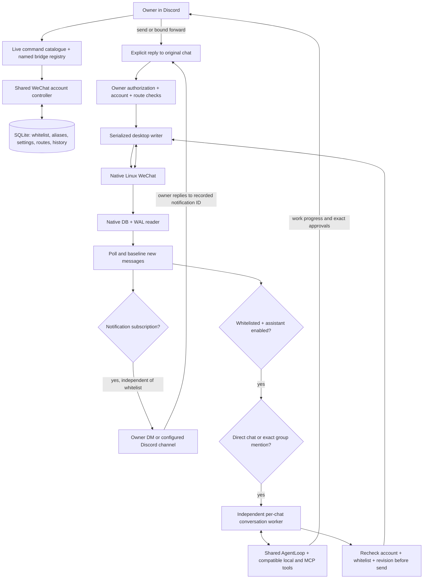
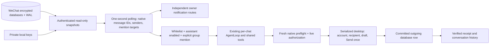

# Discord → WeChat account bridge

This is a named `$bridge wechat` integration for the native Linux desktop client. Run the bot
in Discord mode. The separate Windows `--mode wechat` adapter runs the bot directly inside WeChat.
The maintained `example` bridge is a local echo demonstration; personal integrations remain ignored.




## Setup

The Pi integration was checked against WeChat **4.1.13.26**, English UI, default light message bubbles.
The native backend reads authenticated local database snapshots; the desktop backend uses AT-SPI.
Both use the logged-in desktop session for sending and expose no HTTP listener.
The desktop backend has the following UI limitations: it exposes text through AT-SPI, but not all sender/direction metadata.
For sparse text rows, the helper checks the rendered light bubble. Unknown directions/themes and media
rows are excluded from automatic replies. Sender names can be absent; the bridge does not invent them.
Each message read captures the rendered view once. Selecting a conversation is idempotent, so polling
does not click an already-selected sidebar row and accidentally close that conversation.

System packages:

```bash
sudo apt-get install at-spi2-core gir1.2-atspi-2.0 python3-pil xdotool grim libzstd1
```

Set `WECHAT_BRIDGE_OWNER_ID` to your Discord user ID, or use the existing `CREATOR_USER_ID`.
Account status, QR, message reads, notifications and sends all require that owner. Results and notifications
go to the selected destination. Notifications accept `--destination here` (the invoking channel)
or `--destination dm` (the configured owner's DM). Choose the intended private destination.

The defaults use `/usr/bin/python3`, display `:0`, Wayland capture on `wayland-0`, and the current user's
`/run/user/<uid>/bus`. The helper launches WeChat with `QT_QPA_PLATFORM=xcb` and accessibility enabled.
An already running client needs to have been launched that way; a manually launched native Wayland client
can expose inaccurate coordinates or lack accessibility. This does not change neighboring service files.

Optional overrides are in `config.example.yml` / `.env.example`. `BRIDGE_DEFAULT` is `example`.
An explicit named command remembers that bridge for subsequent commands in the same Discord channel.

## Commands

```text
$bridge --help
$help bridge
$bridge example --init
$bridge example --send "hello"
$bridge example --listen on

$bridge wechat --status
$bridge wechat --login
$bridge wechat --chats
$bridge wechat --messages "Alice" --limit 10
$bridge wechat --send "Hello!" --to "Alice"

$bridge wechat --notify on --chat "Alice"
$bridge wechat --notify on --chat all --destination dm
$bridge wechat --notify off --chat "Alice"
$bridge wechat --notify off --chat all

$bridge wechat --whitelist list
$bridge wechat --whitelist defaults --mention "Account Nickname"
$bridge wechat --whitelist add --chat "My Group" --kind group --mention "Group Nickname"
$bridge wechat --whitelist add --chat "Alice" --kind direct
$bridge wechat --forward on --chat "Alice"
$bridge wechat --forward off

$bridge wechat --agent on --chat "Alice" --delay 20 --instructions "Keep replies brief."
$bridge wechat --agent status --chat "Alice"
$bridge wechat --agent off --chat "Alice"
$bridge wechat --whitelist remove --chat "Alice"
$bridge wechat --approve --chat "Alice" --task "exact ID from the approval notice"
$bridge wechat --cancel-work --chat "Alice"
$bridge wechat --disconnect
```

Quote names/messages containing spaces. `--to` and `--chat` accept a chat name or the ID returned by
`--chats`. Current Qt IDs are derived from display names when the client omits native IDs; duplicate
names are rejected. Reconfigure a renamed conversation. Recent chats can be scrolled into view; missing
recipients use contact/group search. Internet suggestions, favorites and history hits are excluded.

`--login` attaches the current login-window QR in Discord. Refresh it by running the command again.
After scanning, confirm on the phone if requested. A visible desktop `Log In` control is handled too;
the polling controller can finish this step for three minutes after a login command. It announces login
only after observing a ready account. With multiple local account folders and no exposed profile identity,
automatic sending pauses rather than guessing the account.

With the desktop read backend, automated text replies use one serialized desktop session with a prepare/commit exchange over private
stdin/stdout. The helper checks the account, selects the chat and returns its latest messages; the
controller cancels on a manual reply, merges newer input and rechecks the live whitelist before committing.
The same helper then verifies the account, recipient and draft, sends once, and returns the outgoing receipt.
Background polling cannot switch chats between these phases. Account status scans reuse one accessibility
tree snapshot instead of repeatedly walking the same tree. Direct accessibility insertion remains the
text-entry method: a live Unicode/multiline draft benchmark measured about 3 ms per warm insertion versus
32 ms for clipboard paste. The draft was cleared without sending, and the text clipboard was restored.

Manual sends preserve an existing draft, verify the selected recipient and entered text, then look for
a newly displayed outgoing message. A receipt means the desktop shows the message; it is not a delivery
or read receipt from the recipient. An unverified send is reported and never retried automatically.
Do not send again until checking the desktop, since a click cannot be undone by cancelling a task.

## Live reply whitelist and forwarding

The reply whitelist is stored per account in SQLite, not in source code or a group-name list in the
prompt. Existing conversations migrate to **not whitelisted**. Adding a conversation permits replies;
`--agent on` separately starts its assistant. Removing it also disables its assistant and cancels pending
work. Settings apply live, and queued automated sends recheck authorization after acquiring the UI lock.
Whitelist membership also gates a continuously bound Discord-to-WeChat forward route and scheduled
assistant deliveries. Explicit owner `--send` and native replies to forwarded notifications remain manual
owner actions. Notifications never grant permission for AI replies.

Each allowed conversation has a configured `direct` or `group` kind. Unknown kinds pause AI replies.
A group assistant receives only incoming messages explicitly addressed to this account and its own
outgoing conversation history. Group chatter and mentions of other people do not trigger or steer it.
Native per-message mention metadata takes precedence when available; otherwise exact configured
`@nickname` spans/boundaries are checked. An unread `@me` badge alone cannot authorize a batch of messages.
This Linux client currently exposes names, not reliable account-ID mention entities. Similar-looking emoji
remain distinct Unicode nicknames; enter the exact spelling rather than a description of the emoji.
`--agent status` includes the latest incoming routing decisions, and `[wechat routing]` logs record
accept/reject reasons without message contents. Keep aliases current
when a group nickname changes. Account defaults use `--whitelist defaults --mention ...`; a group's
repeatable `--mention` options replace those defaults. No tennis-ball nickname is built into the code.

`--forward on --chat ...` binds one Discord channel to one whitelisted WeChat conversation. Only the
configured owner's ordinary text is relayed. Commands are excluded, the destination is explicit and
persistent, and `--forward off` stops that route. Configure `--notify` separately for the return direction.
Alternatively, use Discord's native Reply on a forwarded notification: the bridge looks up its recorded
Discord message ID, channel, account and origin chat. It cannot be redirected by editing/copying the
notification text, and an unknown reply reference is refused on a bound relay. Notification routes retain
the latest 2,000 receipts. Native replies do not enable any AI assistant.

`$bridge --help` and paginated `$help bridge` render the same command catalogue used by the parser,
including the live list of registered bridge factories. Room-agent bridge tools invoke this same path.
The desktop transport, command schema and whitelist rules are shared across all conversations.

## Notifications and per-chat takeover

Polling defaults to **five seconds between cycles**, plus desktop-operation time. This is near-real-time
desktop polling, not a server event stream. One account transport serializes UI operations; reply generation
is independent per chat. Opening a conversation can consume its unread badge.

Each chat can inherit all-chat notifications, explicitly enable its own destination, or opt out while
all-chat notifications remain enabled. Startup baselines existing messages rather than forwarding/replying
to old history; with the native reader, recent messages that arrived while the bot was stopped are still
routed (see [restart catch-up](#restart-catch-up-october-15)). Unsupported views/media can produce a labeled unread/activity preview instead of an
invented full message. Incoming media is currently forwarded as activity/preview text, not downloaded
and mirrored as a Discord attachment. Outgoing tool-generated files use the verified file-send path.
Discord mentions are suppressed in forwarded text.

Takeover is **off by default**, and only the configured owner can enable it for a whitelisted conversation.
Notification subscriptions are independent: any chat can notify the owner while its assistant stays blocked.
The worker uses `deepseek_default_prompt` from `llm_config.json` independently of its model engine.
Set `WECHAT_BRIDGE_REPLY_PROVIDER=deepseek` (default) or `luna`; these select `AGENT_DEEPSEEK_MODEL`
(default `deepseek-flash`) or `AGENT_LUNA_MODEL` (default `gpt-6-luna`). `WECHAT_BRIDGE_REPLY_MODEL` is an
optional explicit override. The selected character's `AGENT_*_BACKEND` also supports its configured
OpenRouter route. Restart the bot after changing engine configuration. No chat settings/history or
whitelist entries need to be recreated. Status shows the actual provider, model and backend; timing
logs identify the engine separately from the persona. Requests use low effort and a hard 35-second
timeout per generation. It receives bounded history and that chat's owner
instructions, using the existing `AgentLoop` for conversation and work. Every enabled assistant chat gets
the shared tool registry automatically; there is no video-specific planner or separate task classifier.
It speaks briefly before acting, examines structured results, and continues through the requested outcome.
Room teammates and character diaries remain separate. Received messages cannot change configuration.

Tools declare platform capabilities. Discord voice, editable clocks and cross-channel broadcast/account
control are unavailable to these reply-only workers. Compatible local and configured MCP tools remain
available. Tools can deliver only to their current conversation. Enabling a whitelisted chat preauthorizes
text/file delivery there, including prepared clips and retained-file recovery. Such tools declare
`approval_scope=conversation_delivery`; the scoped agent loop checks the live whitelist, enabled state,
revision and tool ownership before allowing them without another confirmation. Their write classification
and duplicate-write protection remain in place. Server changes, other writes and owner-only tools still
require the Discord owner's approval of the exact retained actions and task ID; a contact saying "yes"
cannot approve those operations.
`--agent status` shows pending work. `--cancel-work`, disabling the agent or a manual reply cancels it.
Pending tasks and approvals are in memory and do not survive a restart.

Tool stages and elapsed-time updates go to active Discord control channels, including when ordinary
message notifications are off. These are observable progress, not private reasoning. Provider/tool timing
is correlated in `chat_latency.log`, without recording raw conversation text. Worker timings distinguish
the gathering window, generation, delivery queue/cooldown and final checks. Each desktop operation in a
reply request reports its UI-lock queue time separately from helper execution time. These worker timers
start at detection; they do not include time before the desktop poll noticed the incoming message.

Prepared attachments use the same delivery contract as other tools. The default **100 MB** budget is a
local policy, configurable with `WECHAT_BRIDGE_MAX_UPLOAD_MB` (1–100); it is not a claim about WeChat's
maximum server limit. The installed Linux client's exact server limit has not been established. A user
can request a smaller output with `download_video.max_size_mb`; this cannot raise the local budget.
Video fitting adapts audio bitrate along with video bitrate, keeping the full requested duration unless
the user chooses a shorter range. A full-duration request without explicit resolution, fps or bitrate
first looks for an H.264 + AAC source pair that fits the budget and stream-copies it; only otherwise does
the Pi re-encode in software. Estimates, measured render sizes and actual upload failures remain
distinct evidence; a failed estimate must not be described as a WeChat rejection.
The helper verifies the selected path, a single
new file object in an initially empty editor, and the outgoing message after Send. MP4s can appear as
inline videos with no exposed filename, so the receipt requires a new outgoing media card after upload
progress finishes. A file operation can wait up to 90 seconds for that evidence; it is never retried.
The transport keeps a private outbox copy for asynchronous upload, cleaning copies older than 24 hours
when another file is staged. Ambiguous sends retain their prepared files. Recovery delivery uses a
conversation-scoped artifact ID and the current chat’s whitelist authorization; completed preparation is not repeated.

Incoming messages use a short gathering window (`WECHAT_BRIDGE_COALESCE_SECONDS`, default one second,
configurable 0–5) before generation. Generation runs during any remaining outbound cooldown, so an idle
conversation does not pay a fixed 20-second delay before the model starts. `--delay` now sets the minimum
send interval for that chat (default 20 seconds, configurable 5–3600); account-wide sends remain at least
20 seconds apart. Both intervals are enforced at delivery, including multiple work updates from one run.
Direct-chat bursts are merged; new direct messages arriving during generation replace stale replies. Group @mentions are separate queued requests, each bound to its triggering native message and sender; later mentions do not replace the current request. A manually observed outgoing reply, explicit manual-send command, disable/change
of configuration, account change or sign-out invalidates queued replies. Workers do not initiate contact;
an explicitly requested, owner-approved reminder can deliver later through the account's channel route.
Slow, reply-only behavior does not guarantee the account will avoid platform enforcement.

Preferences survive restarts in SQLite, scoped to `(account, chat)`. Runtime context is a bounded private
transcript (400 retained messages, at most 30 / 12k characters supplied), separate from character diaries.
Generated replies enter history only after a verified send. UI fingerprints distinguish repeated messages
within the observed window; they are not native immutable message IDs. Large bursts, edited messages,
renames, off-screen history and client UI changes remain limitations of this desktop transport.

`--disconnect` pauses the account bridge and disables automatic resume without logging out the desktop.
Normal bot shutdown saves preferences and closes workers, allowing configured subscriptions to resume.

## Implementation and validation

| File | Responsibility |
| --- | --- |
| `features/feature_bridge.py` | Named factories, persistent channel selection, owner authorization. |
| `parsers/bridge_commands.py`, `parsers/bridge_parser.py` | One command/help catalogue, quoted text, recipients and independent options. |
| `bridges/bridge_base.py`, `bridges/example_bridge.py` | Generic lifecycle/command contract and runnable example. |
| `bridges/wechat_bridge.py` | Shared account, QR commands, polling, notifications and worker coordination. |
| `services/wechat_desktop.py` | Serialized, bounded helper calls with private stdin JSON. |
| `scripts/wechat_desktop.py` | Linux controls, contact search, text rows, input and screenshot evidence. |
| `services/wechat_native.py`, `services/wechat_database_pages.py` | Read-only authenticated database/WAL snapshots and native message metadata. |
| `services/wechat_native_transport.py` | Independent native reads with checked desktop writes and native receipt correlation. |
| `scripts/wechat_database_keys.py`, `scripts/wechat_database_probe.py` | Explicit private key setup and content-free readiness diagnostics. |
| `services/wechat_conversations.py` | Durable preferences, bounded history, independent reply workers. |
| `services/wechat_agent.py` | Shared agent loop, scoped tools/files, exact owner approvals and resumption. |
| `providers/wechat_reply.py` | Stable DeepSeek persona, configurable model engine and validated work steps. |

The AI room also exposes owner-gated `bridge_status`, `bridge_read`, and `bridge_control`; control actions
use the existing central write-approval flow. Direct `$bridge` commands are explicit owner instructions.

Offline checks cover the shared help/parser catalogue, live whitelist revocation, exact group mentions,
notification-only chats, trusted native reply routing, owner restrictions, QR attachments, notification inheritance/opt-outs, baseline
behavior, throttling, manual cancellation, stale-generation replacement and ambiguous sends. Live checks
on the Pi verified QR login, account status, chat discovery, Unicode draft entry/clearing, scrolling, and
the exact user-provided phone message through owner commands and repeated reads. An explicitly approved
test with the second account **Beast IX** verified a live automatic reply and the user's exact Bilibili
video request. The first file test exposed a missing Send step; that send was completed once, without
reopening the picker or sending the file twice. The helper now handles staging and upload completion.
The user confirmed the video arrived, played, and had a brief model completion message. Scrolling also
exposed virtualized time anchors; the transport preserves overlapping row identities. Tests stayed in
temporary databases and enabled no persistent takeover. Other media types and arbitrary MCP workflows
have not all been exercised live; the desktop transport remains dependent on this client UI.

AT-SPI references: [text access](https://gnome.pages.gitlab.gnome.org/gtk/atspi2/class.Accessible.html),
[editable text](https://gnome.pages.gitlab.gnome.org/at-spi2-core/libatspi/method.EditableText.set_text_contents.html).

The three owner-requested group conversations are configured in the local database with assistants enabled
and group-mention gates. Group nicknames are runtime configuration. No live test message has been sent to
those groups as part of setup; group mention handling is covered by offline transport/worker tests.


## Native database reader

The Pi uses the native database backend, verified against Linux ARM64 WeChat
4.1.13.26. Contacts, session summaries and messages are read locally from the
account's encrypted databases and committed WAL. The desktop remains responsible
for login and sending. Native reads do not select chats, mark messages read or
wait for the desktop control lock.



Configure `WECHAT_BRIDGE_READ_BACKEND=native`, `WECHAT_BRIDGE_DATABASE_ROOT` to one
account's `db_storage`, and optionally `WECHAT_BRIDGE_DATABASE_KEYS` (default
`temp/wechat_native/keys.json`). The example configuration retains `desktop` as the
default so a new installation does not require database setup. Native reading is
explicit: missing keys or unsupported schemas fail closed, without silently mixing
native message IDs with desktop fingerprints. To return to the desktop reader,
set the backend to `desktop` and restart the bot.

Native groups use the account's exact username in `msgsource/atuserlist`, including
compressed metadata, rather than matching a nickname in the text. Typing an apparent
@mention does not qualify. The existing nickname settings remain useful for the
desktop backend. Text, image/video/voice/file activity and incoming/outgoing direction
are classified from native records. Media XML is not supplied as conversation text;
unsupported compression or metadata cancels pending work conservatively. System
libzstd handles ordinary compressed fields; dictionary formats fail closed.

Existing `name:` settings are pinned once to a uniquely resolved native username in
`wechat_native_bindings`. Their whitelist, routes and history remain intact. The
binding survives a rename and cannot transfer to a new group that reuses the old
name. New conversations expose `native:` IDs. A duplicate desktop label still blocks
sending because desktop selection must remain unambiguous.

Polling uses one-second intervals; desktop account readiness is refreshed every 15
seconds. Every automatic text send additionally obtains a fresh desktop account check,
selects the recipient and holds that selection through the private prepare/commit
protocol. Preflight reads and the outgoing receipt come from the native database.
An ambiguous receipt never retries Send. Same-chat observation waits for receipt
correlation so the bot cannot mistake its own outgoing row for a manual reply. Native
manual replies are distinguished by message ID, including repeated identical text.
Manual/file sends retain their desktop controls and add native receipt correlation.

The low-level reader authenticates SQLCipher-4 pages, validates WAL checksums and
applies only committed transactions. Plaintext exists in memory in a query-only
SQLite connection. Brief nonblocking shared SQLite locks prevent checkpoint/reset
races during capture; live files are never created or opened writable. Cache reuse
checks content hashes as well as file metadata. A new message shard requires its own
validated key; it pauses native reads until setup is refreshed.

### Key setup and diagnostics

`scripts/wechat_database_keys.py` is an explicit one-time setup utility. It is never
invoked by the bot or on incoming messages. Process reading requires the account
owner's approval and OS permission. Scans are bounded by bytes, elapsed time and
context count, with no debugger, injection, process writes or raw-memory dumps.

This client masks in-memory keys with a constant vector. The recovery utility derives
candidate masks from ARM64 ELF instructions in the installed binary, without fixed
addresses; every recovered key must authenticate its account database before storage.
The original scan missed this mask. The corrected recovery authenticated all three
current databases, which passed SQLite integrity checks.

Successful recovery atomically writes `temp/wechat_native/keys.json` with mode 0600
in a mode-0700 directory. `temp/` is git ignored. The loader rejects shared files,
symlinks, mismatched accounts and unsupported cipher profiles. Never include keys in
logs, prompts, chat or Git. Key recovery is separate from normal bot privileges.

```bash
# After owner approval; select the native main process, not a helper process.
sudo venv/bin/python scripts/wechat_database_keys.py --pid <native-wechat-pid> --database-root /path/to/account/db_storage
# Run the diagnostic as the normal bot user, not root.
venv/bin/python scripts/wechat_database_probe.py --database-root /path/to/account/db_storage
```

The diagnostic authenticates snapshots and checks SQLite integrity without printing
messages or keys. `--schema` also prints table/column names. It does not enable replies.
Offline tests cover actual SQLite WAL/checkpoint locking, masking recovery, private
key handling, native schema/identity mapping, Zstd, explicit mentions, stable IDs,
manual reply detection, native receipts and the existing whitelist/revocation rules.
A local parity check recovered the owner's exact earlier File Transfer test text and
all previous explicit group mention targets. First-read measurements for the four
configured groups were about 36 ms total, independent of desktop access. End-to-end
model and delivery latency must be measured separately from these read timings.

The deployed native backend passed 509 regression tests. A real desktop delivery preparation
selected the whitelisted test group, checked 23 native messages, and cancelled before commit
in about 1.25 seconds, without composing or sending a message.

The owner's fresh live @mention on October 14, 2026 at 21:45 PDT completed through
the native backend (request `f818756f8814`). Native mention routing accepted one
incoming message and one reply was correlated to a new committed outgoing row,
stored as `source=agent`. Worker-start to verified reply was 7.336 seconds; routing
acceptance to receipt was about 7.9 seconds. The model call took 2.593 seconds and
checked desktop delivery took 2.768 seconds, with zero desktop-lock queue wait.
The one-second gathering window plus scheduling/check overhead took 1.915 seconds
before generation. WeChat's incoming server timestamp is only second-resolution
and preceded routing by about 3.3 seconds; it is not a measurement of when the
local database commit became readable. These timings therefore distinguish worker
latency from transport/polling latency. Previous comparable worker timing was
9.449 seconds before native reading. Model generation, checked desktop sending
and scheduling/storage overhead remain opportunities for further optimization.


## Group reply targets and history cursors

Every enabled group request is anchored to one explicit @mention. Later mentions
queue separately; ordinary group chatter can notify the owner but does not become
input or cancel the active request. Context is scoped to that sender's addressed
turns and prior assistant replies linked to that sender. Tool messages also carry
the actual triggering participant identity. A pending approval retains its original
request while later mentions wait; clarification from that same participant can
resume the original request before unrelated queued work.

Text replies use the client's native **Quote** action. The writer aligns visible
bubbles with ordered native message context to identify the exact incoming message,
even when its text repeats. It verifies the quoted preview before Send, and the native
reader verifies that the new outgoing quoted record references the original server
message ID. If the target is absent, the sequence is ambiguous or it cannot be verified, it fails
closed rather than posting an unquoted or misdirected reply. Text work updates
retain the same quote target. Attachments remain associated with the same scoped
request; attachment cards themselves use the existing file-delivery contract.

Native stream positions distinguish new events from history expansion. Startup
baselines the current position; a larger pre-send history window cannot reclassify
hours-old outgoing messages as a new manual reply, notify old incoming messages,
or replay old mentions. Genuine new manual replies, live policy revocation and
account changes still invalidate pending work. Cancellation reasons and verified
reply IDs are logged explicitly.

This fixes the missing reply in 找工作: the normal poll read 40 messages while final
preflight read 100. Newly discovered historical outgoing messages had invalidated
the current request before commit. The regression suite covers that mismatch,
separate group queues, sender ownership, quoted native receipts and real manual
reply cancellation.

## SQLite writes and editor sidecars

The conversation store initializes its schema once per database file and reads
existing settings before attempting insertion. Repeated observations check existing
message IDs before writing. Previously, `INSERT OR IGNORE` into the AUTOINCREMENT
message table still advanced SQLite's sequence for duplicates, creating unnecessary
rollback-journal churn during every poll. Idle repeated reads no longer do that.

The local `.vscode/settings.json` excludes `**/*.db-journal`, `**/*.db-wal` and
`**/*.db-shm` from Explorer and file watching. These remain legitimate SQLite
transaction files; never delete an active journal to suppress editor flicker.

The October 14 repair passed 519 tests. One bounded recovery sent a quoted reply
to the previously unanswered 找工作 trigger, verified against its original server
ID and recorded with the correct `reply_to_id`. Its trace is `8d249cdc7c3e`;
only one outgoing quote referenced that trigger. The service then resumed with
the queue, cursor and duplicate-write fixes.

## Waiting for an answer and avoiding repeated work

The live video request traced as `8f43aafbaecb` exposed a separate control-flow error: a download returned
`needs_input`, but `ask_clarification` was normalized as ordinary success, allowing another download
before the participant answered. The per-run prompt also omitted its already delivered `visible_turns`.
Stored conversation history alone cannot enforce suspension, and it was loaded before those updates.

The common agent context now includes recent visible turns and an `input_required` flag. A tool that
requires user input prevents subsequent work actions until a real answer resumes the request; another
poll or approval event does not satisfy that condition. Registered question tools declare their prompt
argument and map directly to one `needs_input` conversation step, without executing a fake successful
work action or emitting a second acknowledgment. This applies through tool metadata, not chat names,
video URLs or provider-specific branches.

The former 10 MB default was a bridge policy, not an observed client rejection. This particular 385.45 s
video failed the old estimate because fixed 128 kb/s audio left less than the minimum video bitrate.
Adaptive 64 kb/s audio permits a full-duration estimate below 10 MB. Actual output size is still checked
after rendering; this estimate alone does not establish successful download or delivery.

Validation: all 525 tests pass, including tool-driven question suspension and resume. A synthetic live
DeepSeek Flash request returned `needs_input` with no actions in 2.421 s; no conversation history or
messages to contacts were involved. An eight-second generated media fixture passed through the real
renderer and ffprobe confirmed an eight-second output with about 65 kb/s audio, verifying that the new
audio setting reaches FFmpeg. The full public video has not been redownloaded or resent by this check.

## Five-chat routing and repeated-message repair (October 14)

The next live investigation found two independent failures: Beast IX had only been
enabled in earlier temporary test stores, and repeated identical group requests
were rejected by the quote selector. The production store now enables Beast IX's
direct conversation and the four configured groups. Group replies still require
native explicit mention metadata; notification settings remain independent.

Quote preparation now preserves the exact native message ID and server ID and
aligns the visible bubble sequence with fresh ordered native context. Repeated
text alone is not ambiguous. A missing target or genuinely ambiguous sequence
still prevents Send. Operational errors now include their current detail instead
of retaining an older error code.

Live checks verified direct replies in Beast IX and exact quoted replies in
垃圾桶 (trigger 33, reply 34, trace `1293cd8c3a09`) and 《乌鲁克氮泵》
(trigger 3, reply 4, trace `0b71408159db`). The other two groups were checked for
configuration and polling, without sending unsolicited test messages.

That run also exposed a file-receipt bug: the desktop could send a video but fail
to recognize its outgoing card. Native mode now releases the desktop after the
single Send and waits up to ten minutes for a new outgoing media record with a
nonzero server ID. A staged record with server ID zero is not completion, and
an uncertain send is never automatically repeated. Verified outgoing media is
treated as an agent echo, not activity that cancels the completion step.
The short live video obtained a server-confirmed record; the 86.66 MB full-length
video was still uploading during the repair check. Neither file was resent.

Conversation history is explicitly background rather than an unsolicited task
backlog. The shared attachment-reading tool now declares its attachment-history
capability, so WeChat cannot advertise it before incoming media is actually
available through that store. A synthetic DeepSeek greeting with old image
placeholders returned one completed greeting with no actions.

Validation: 531 regression tests passed, including repeated quote targets,
native upload commit detection, single-click file submission, and unsupported
attachment capability filtering. Production startup confirmed all five chat
baselines and the DeepSeek Flash reply engine.

## Restart catch-up (October 15)

The mention `@⚡BeastIX 大肥鱼说句话` in 《乌鲁克氮泵》 (native message 7, 23:54:59 PDT) carried
the account's exact `atuserlist` target, so routing would have accepted it. It arrived while
`discordstudybot.service` was stopped (23:49:14–23:56:06) for a one-off recovery run. On start, the
bridge baselined all seven visible messages, including the mention, as handled history. The read
position was only in memory, so nothing distinguished "observed before" from "arrived while stopped".

The supervisor now persists each chat's native read position with the settings revision it was
observed under (`wechat_read_cursors`). At startup, or when the account becomes ready again, messages
after that cursor and newer than `WECHAT_BRIDGE_CATCHUP_SECONDS` (default 900, 0 disables, maximum
3600) go through the normal routing path: whitelist, explicit mention, manual-reply cancellation and
quoted delivery all still apply. No cursor (first start), a changed settings revision, or older messages
keep the plain baseline, so enabling a chat never answers backlog. The cursor is written only when it
advances. Work already in flight when the process stops is still not resumed. Startup logs show
`catch_up_messages` counts without message contents.

The same night's 86.66 MiB full video (request `1293cd8c3a09`) spent about 58 s downloading an AV1
source (58.5 MB) and about 205 s re-encoding it on the Pi with software x264 (measured 0.53x real time),
producing a larger 90.9 MB file. It then waited 34 s for the desktop lock held by another chat's file
receipt check and its upload never received a server ID (`status=1`, `upload_status=2`) before the
desktop client exited around 00:10. A fitting H.264 source (1280x548 + AAC, 80.5 MiB) was available;
the new stream-copy path prepared the same full video in 43 s live, verified by `ffprobe` (385.45 s,
H.264/AAC, 30 fps, `moov` first). That check did not send anything to WeChat. Whether this Linux client
completes inline uploads of this size remains unverified.

### Why replies stopped later that night

- The desktop client exited around 00:10 and on relaunch waited at **Confirm on Phone**. The
  helper reports that screen as `unavailable`, and the bot announces lost readiness only on a
  ready-to-not-ready transition, so after a restart nothing told the owner. Polling stops while the
  account is not ready; nothing relaunches the client automatically.
- In 垃圾桶 the account's group nickname is 🥎🥎🥎🥎. Typing `@⚡BeastIX` there produces plain text
  with no `atuserlist`, which strict native routing correctly rejects as `other_mention`. Only a
  mention picked from WeChat's member list triggers a reply.
- A file receipt held the chat's lock for up to ten minutes, and polling waited on that lock, so
  one upload froze observation of every chat. Polling now skips a chat whose receipt is in flight.
  The receipt loop decrypted a snapshot every 0.1 s; one transient `DatabaseSnapshotError` while
  WeChat rewrote its WAL ended the wait after 61 s and reported `delivery_failed` for a video that
  was delivered at 00:54. Files now poll once per second and tolerate transient snapshot errors until
  the deadline. Verified receipt IDs are remembered by the transport, so the poller cannot mistake
  the bot's own media for unsupported/manual activity before it is recorded.
- WeChat itself re-compresses inline videos before uploading (`wxutility`, about 3 minutes at 1.5
  cores for 385 s of 1280x548 video), then uploads at roughly 1.6 Mbit/s. The 80.8 MiB stream-copied
  file reached a server ID about 9.5 minutes after Send.

### Long requests and image tools (October 15, 01:03)

`@⚡BeastIX 那你用gpt画一下这个：…` (2,159 characters, 33 lines) was accepted, but its quoted reply
failed with `The recipient could not be scrolled into view`. The click helper required a list item to
fit entirely inside the visible list, which a bubble taller than the chat viewport never can. A failed
spoken update stops the worker, so the drawing tool never ran. Tall items are now accepted once a
clear slice is visible, and the click point is clamped into that visible slice of the same bubble.

`generate_image` was fixed to Gemini. It now takes an optional `provider` (`gemini` default,
`openai` when the user explicitly asks for GPT/ChatGPT/OpenAI/DALL-E), the same choice as
`$draw -p`. The resent request quoted the long trigger, drew through OpenAI and delivered the image.

That run exposed two follow-on faults. A delivered tool file still carried `Retained artifact ID` in
its summary, so the model tried `deliver_prepared_file`, got "not retained", and wrongly told the
group the image had failed. The ID now appears only when delivery did not succeed. Repeating a
completed write or preparation then stopped the loop and posted the fixed English sentence "That
state-changing action already succeeded" to the group. Like the shared room, the loop now reports
the earlier success to the model (`already_completed`) without re-running it; a second repeat ends
the run quietly. Other `AgentLoop` stop messages are still fixed English text.
