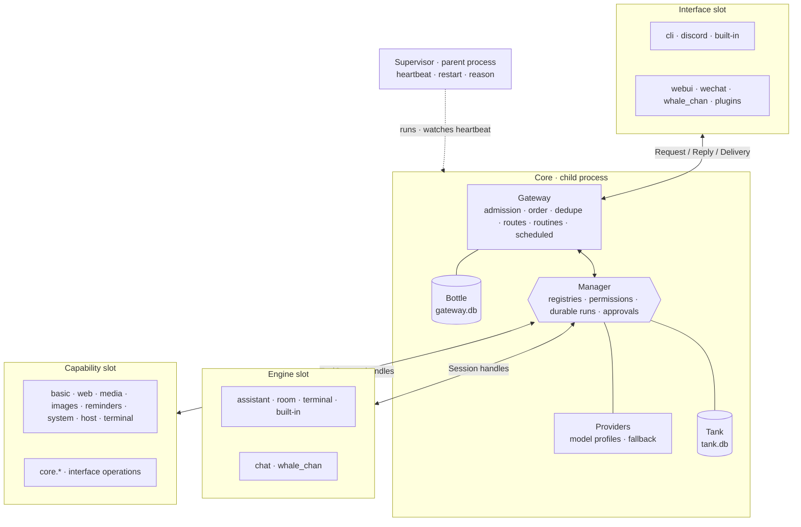
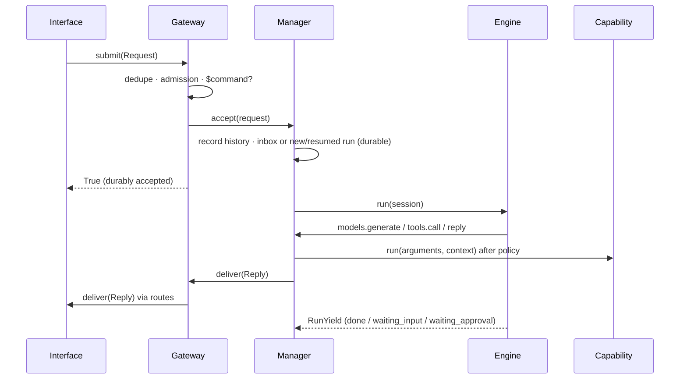
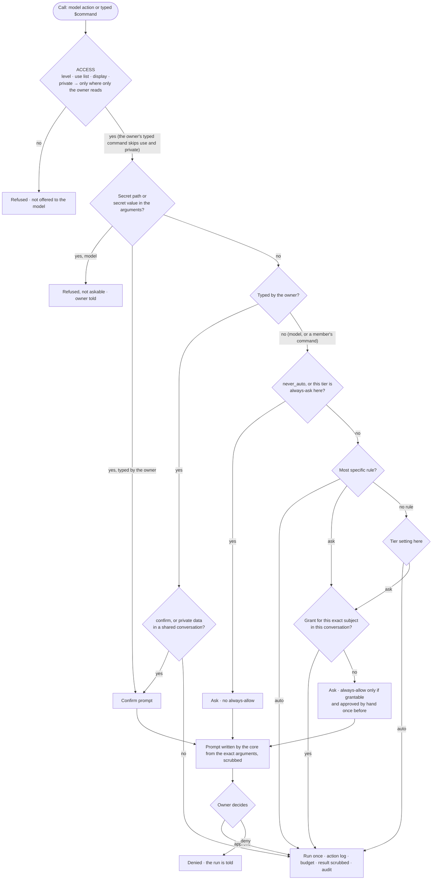

# Core architecture

The core is a small, fixed runtime. Everything that talks to a platform, decides what to say, or
does work is a module (built-in in `extensions/`, external in `plugins/`) plugged into one of three slots. The core and each extension see each
other as black boxes; the only shared code is the [`contracts`](../../contracts) package.



| Block | Does | Owns | Never |
| --- | --- | --- | --- |
| Interfaces | Platform I/O; convert events to `Request`; render `Reply`; report `Delivery` | Platform connection; its section of the bottle | Decide replies, call capabilities, read the tank |
| Gateway | Single entry; per-conversation order; duplicate drop; admission rules; `$command` detection; reply routing; routines; scheduled messages | `gateway.db` (interface sections, seen IDs, rules, routes, routines, scheduled messages) | Feature logic, model calls, tank access, formatting |
| Manager | Registers engines and capabilities; picks the engine per conversation; hands out handles; decides permissions (access, approval, enforcement) on every call; durable runs and approvals | `tank.db` (history and its summaries, runs, events, actions, approvals, grants, modules' scoped stores, persona diaries) | Feature logic, prompts, platform formatting |
| Engines | Turn loop through `Session` handles | Their run state (saved through the session) | Import providers, storage or interfaces; bypass policy |
| Capabilities | One action; returns `ToolResult` | Nothing durable except their extension's store | Call other capabilities or engines; talk to the user |
| Providers | Model profiles with ordered candidates and fallback; thin SDK adapters | Credentials (from environment) | Prompts, history, storage |

## Rules

1. Dependencies point inward only. `contracts` imports the standard library only; `core` imports no
   extension; extensions import `contracts` plus their own code.
   [`tests/test_core_boundaries.py`](../../tests/test_core_boundaries.py) enforces this.
2. Only interfaces know platform details. Platform facts travel as `Request` fields
   (`is_direct`, `mentions_me`, `display`, `extra`).
3. Only the Manager touches the tank; only the Gateway touches the bottle.
4. The Manager holds wiring and policy, never feature logic.
5. Each capability has one definition, used by `$commands` and engines alike.
6. Engines never start detached work. Autonomy comes from gateway routines.
7. Permissions are decided in one place, the Manager, in three layers (access, approval, enforcement).
   Configuration can make a capability stricter than it declares, never weaker.
8. The core owns how models are called (the Providers block, its fallback, and the built-in kinds
   `openai_compatible`, `gemini` and `anthropic`), not which vendors exist. Its default vendors and
   models ([`core/defaults.py`](../../core/defaults.py)) are configuration. A module may add provider
   kinds of its own, providers and profiles, so a new vendor never needs a core change.

## Request lifecycle



## Durable runs

A run is created per accepted request (or resumed for an answer). Its record, event log, engine
state, action log and approvals live in the tank. Statuses: `running`, `waiting_input`,
`waiting_approval`, `done`, `failed`, `cancelled`.

* A run holds its lane (the conversation, or with `lane: sender` the conversation plus sender for group
  messages) only while it is thinking or waiting for input. A new message goes to the newest holding
  run: into its inbox if it is thinking, as the answer if it is waiting for input. While a run waits on a
  capability or a file delivery (tracked in memory by the Manager) or for approval, it holds nothing and
  new messages start parallel runs, as in the shared room: long work never gates the conversation.
  `Session.activity()` shows each run the other open work in its conversation. Unread inbox messages
  start a new run when a run ends.
* Before a run's output is delivered, the Manager re-checks that the run is open and its assignment
  enabled, and the Gateway that the conversation is still admitted. Time spent inside interface
  deliveries (uploads, send spacing) is excluded from the run's time budget.
* On start, every `running` run is resumed with a `resumed` event. Engines replay from their saved
  state; `call_id`s make tool calls idempotent.
* The action log records each capability call as `started` before and `done` after. A repeated
  `call_id` returns the stored result. An action interrupted by a crash is re-run only if it is a
  read; prepares and writes return `uncertain_previous_attempt` and are never repeated.
* Identical prepares or writes without a `call_id` run once per run (signature deduplication).

## Policy

Assignments map address patterns to an engine, personas, a budget, `trusted`, `lane`, `enabled` and
engine `options`. Configured assignments can be overridden at runtime (`core.set_assignment`, stored in
the tank); requests received before a runtime assignment was set do not start runs under it. The most
specific pattern wins (`interface:conversation`, then `interface:*`, then `*`). What may be used in a
conversation and what runs there without asking are [permissions](#permissions), kept apart from
assignments.

* **Budgets** cap model calls, tool calls and active seconds per run; exceeding them fails the run.
* **Diaries.** Engines keep persona notes through `Session.diary`; the core enforces the note format,
  paraphrasing, a per-run write limit and the subject (only the trigger's sender, never in routines).
* **Unattended runs.** Routines fire through the gateway as `origin="routine"` requests in
  `routine:<name>`; their assignment and routes decide where results go, permissions what they may use
  (by default only `basic.*`). `trusted` routines act at the creator's level. Approvals still go to the
  control route and the run waits durably.
* **`$commands`.** `$approve <id> [always]`, `$deny`, `$runs`, `$cancel`, `$tools`, `$help`, `$call` (owner
  runs any capability with JSON arguments), `$permissions` (creator: what applies here, the saved grants,
  revoking one), `$memory` (anyone reads, forgets or clears what personas keep about them in this
  conversation, or in those sharing its `diary_scope`; also reads this chat's rolling summary, which
  admins, or the person in a direct chat, can clear; deliberately not a capability, so models cannot
  delete notes), `$model` (admins: which
  model each persona answers with here and what the providers offer, asked live; a choice per persona and
  conversation is tried before her profile, which stays the fallback; never offered to models), plus
  capabilities that declare a `command`.

## Permissions

Every capability call, whether a model's or a `$command`, goes through three layers in the Manager:

| Layer | Question | Decided by |
| --- | --- | --- |
| Access | May this caller, in this conversation, use the capability at all? | the capability's `access` level, the conversation's `use` list, what the conversation can display, `private` |
| Approval | Given access, does this call run now or wait for the owner? | the call's tier, the conversation's tier settings, rules, saved grants |
| Enforcement | What holds whatever the configuration says? | code: secrets, private delivery, routing, exact-argument approvals, grant limits |

Being allowed to use a capability and being allowed to run it without asking are different questions:
Access refuses (the capability is not even offered to the model), Approval only ever runs or asks.

### Tiers and attributes

Each capability declares a tier (`risk`) and attributes; configuration may make them stricter, never
weaker.

| Tier | Meaning | Default |
| --- | --- | --- |
| `read` | Observes only | runs |
| `prepare` | Creates local artifacts (downloads, renders) | runs |
| `write` | Changes something reversible inside the bot (reminders, notes, routines, music) | asks |
| `critical` | Affects the machine, other people or permissions (shell, saving files, services, sending as the owner, changing policy) | asks; never `auto` by tier or by a pattern |

| Attribute | Meaning |
| --- | --- |
| `private` | The owner's private data (WeChat messages, screen, clipboard, files). Offered only in conversations private to the owner (their direct chat with a bot, or the control route); a run that used it delivers only to its own conversation or the control route, never along a route elsewhere, and asks before any critical action (sending elsewhere included), whatever the rules or grants say. |
| `subject` (+ `subject_kind`) | The argument rules and grants match on (a unit, a chat, an address); `path` subjects match globs and get the secret-path check. |
| `escalate(arguments)` | Raises a call's tier from its arguments, never lowers it. |
| `never_auto` | A model's call always asks; no rule or grant changes that (policy changes, accounts, shell lines). |
| `grantable` | The owner may answer an approval with "always allow" for that exact subject (needs `subject`). |
| `confirm` | Even the owner's own typed command shows a one-tap confirmation. |

### Configuration

One `permissions:` section, keyed by conversation pattern, holds all three kinds of setting; internally
they stay separate. Per setting (the `use` list, each tier, each rule), the most specific conversation
pattern that sets it wins.

```yaml
permissions:
  "*":
    rules:                                   # exceptions to the tier settings
      reminders.create: auto                 # anyone
      "services.restart(navidrome.service)": {creator: auto}   # that level and above, that subject only
  "routine:*":   {use: ["basic.*"]}          # Access: only these
  "wechat:*":
    use: ["*", "!system.*"]                  # everything except
    tiers: {write: always-ask}               # Approval per tier: auto | ask | always-ask
  "whale_chan:*": {tiers: {write: always-ask, critical: always-ask}}
```

* `use`: capability patterns this conversation may use, `!pattern` excludes; default everything.
* `tiers`: `auto`, `ask` or `always-ask` per tier. `always-ask` has no exceptions: no rule or grant
  applies to that tier there. `critical` cannot be `auto`.
* `rules`: a capability (`name`, `name(subject)` or `ext.*`) → `auto` or `ask`, optionally per caller
  level. An explicit rule is final; only a saved grant can turn its `ask` into a run. Rules must name a
  capability or extension (blanket behaviour is what tiers are for). Patterns never make a critical call
  `auto`: that needs the exact name, and the exact subject when the capability declares one.
* Layers: an extension may suggest defaults (`Contributions.permissions`: `use` and `tiers` only for its
  own interfaces, rules only for its own capabilities), its module `config.yml` may set `permissions:`
  under the same limits, and `core.yml` overrides both, setting by setting. Built-in defaults let anyone
  use the basic features (reminders, music, the study clock, their own routines) without asking, and
  limit `routine:*` to `basic.*`.

### Deciding one call



### Approvals

* **Where.** If the owner started the run in their own direct chat with a bot, the request comes from
  that bot, in that chat. Everything else (members, group channels, WeChat, routines) goes privately to
  the control route, never to a member or a group. Without a control route only owners can be asked, in
  their own conversation.
* **What.** A pending approval keeps the exact arguments; `$approve <id>` runs that action exactly once and
  resumes the run with a `tool_result` event, `$deny` with `approval_denied`. Pending approvals survive
  restarts. The prompt is written by the core: the tier, the capability's own one-line description of
  the arguments, who asked and where, all scrubbed of secrets.
* **Always allow.** Offered only for `grantable` capabilities with a subject, never for `never_auto` or an
  `always-ask` tier, and only after the owner approved that exact action by hand once in that
  conversation, from a private chat. The grant is built by the core from the call's exact subject (no
  pattern, nothing the model wrote), covers that capability and subject in that conversation only,
  expires after 30 days and is listed and revoked with `$permissions`.
* **Typed commands.** The owner's own `$command` (typed, not forwarded, not a routine a model set up) is
  their approval: it skips Approval and the conversation's `use` list. It still asks to confirm for a
  `confirm` capability, a secret in the arguments, or private data in a shared conversation. Members'
  commands go through every layer like a model's call.

### Enforcement: secrets

Known secret values (everything named in the env files, secret settings, provider key variables,
variables whose names end in KEY, TOKEN, SECRET, PASSWORD, PASSPHRASE or CREDENTIAL(S)), well-known key formats and secret
paths (`.env`, private keys, SSH and cloud credentials, cookie stores, modules' `config.yml`, the core's
databases, plus `secrets:` in core.yml):

| | Scope | Outcome |
| --- | --- | --- |
| S1 | Capabilities with a `path` subject | A model cannot target a secret path; not askable |
| S2 | Tool results | Secret values and formats are scrubbed before a model sees them or they are stored |
| S3 | What the bot sends or keeps: replies, progress, prompts, failure details, stored arguments, command history | Scrubbed; a model's call whose arguments carry a secret is refused and the owner told |
| S4 | The owner's typed commands | A warning confirmation, then it runs with the real value; only the scrubbed form is kept |

These cover only what passes through the bot itself. A process the bot starts (a terminal shell, later
any external agent) reads files, the environment and the network directly as the bot's OS user:
`curl --data-binary @.env …` passes none of S1-S3. There the guarantees are the owner's approval of the
exact line (`terminal.send` is `never_auto`) and the operating system (the service's user, file
permissions, `NoNewPrivileges`, polkit rules for specific units). The core never grants, relaxes or
stands in for OS isolation.

## Owners and control

Owners and the control route come from `core.yml`; the control route is the default private place for
approvals, failure details and interface events. An interface may report the platform's own owner
(`port.set_owners`, e.g. the Discord application owner and their DM); that is used only for interfaces
with no configured owners and when no control route is configured. A reported control route marked
`fallback` (the CLI at an interactive terminal) is used only when no interface reports a real one.

## Access levels

Everyone acts at one of three levels: `creator` (the owners), `admin` (added by the creator with
`$admin add --user <id>`; per platform identity such as `discord:123`) or `member`. Admins can switch
their own admin view off and on (`$admin off|on`) to see the bot as a member. Capabilities and
commands declare the lowest level that may run them, and receive the caller's level
(`ToolContext.access`, `Session.access`), so each one decides what more an admin may see or do; there
is no separate admin command list. Approvals stay with the creator. `$admin lock` makes the bot answer
only the creator and admins (members get one maintenance notice per conversation) until `$admin unlock`.

## Interface reports

Besides `submit`, an interface's port can `notify` the owner (a `Reply(kind="event")` routed by
`kinds: [event]` routes or to the control route; the delivered message ID is kept as a receipt so an
owner's platform reply to it is relayed back to the origin conversation), `observe` activity into
history (idempotent per message ID), `cancel` / `cancel_all` open runs, `set_ready` (transitions notify
the owner; deliveries are refused while not ready), `check` a reply right before committing it, and read
`policy` for its conversations. `submit` returns a `SubmitResult` with the admission reason.

Revocation is immediate: a rule that stops admitting a conversation, or an assignment that is disabled
or removed, cancels the conversation's open runs and expires their approvals. Run output is delivered
only to admitted conversations, including routed targets. Owner forwards (`address → target`) relay the
owner's ordinary messages, again only to admitted targets; `core.send_message` is an explicit owner
send and is not subject to admission.

## Gateway data

* **Admission rules** per pattern: `enabled`, `allow_senders`, `require_mention_in_groups` (default
  true), `owner_only`, `max_age_s`, `commands` (`all`/`owners`). Each rule records when it last changed;
  requests received before that are not admitted, so enabling a conversation never answers backlog.
  Owners' `$commands` bypass admission. Routines are always admitted.
* **Routes** per pattern: `{target, kinds}` sends replies elsewhere (for example `routine:*` to a DM).
  Replies to `routine:*` without a route go to the control route, as does `progress` for interfaces
  whose `display.progress` is false. Routed replies carry `data["origin_address"]`.
* **Routines**: `every_minutes`, `daily_at` (local `HH:MM`, optionally on some `days`) or one-off
  `once_at`. Each firing has a deterministic request ID, so a crash between firing and rescheduling
  cannot fire twice; after downtime a routine fires once, not once per missed slot.
  * *Conversation routines* (`$routine`, `core.add_routine`) belong to a conversation and a creator.
    When due, their text is submitted to that conversation as if the creator had sent it
    (`origin="routine"`): `$status` runs the command, plain text goes to the conversation's engine,
    and the run has the creator's level. They are skipped while the conversation is not admitted or a
    lock keeps the creator out. Members manage their own routines in their conversation (at most 5,
    at least 30 minutes apart); admins see and manage all of them.
  * *Configured routines* (core.yml `routines`, `core.set_routine`) run in `routine:<name>` with their
    own assignment and routes, as unattended system work.
* **Scheduled messages**: one-time `notice` replies (code `reminder`) that capabilities create through
  `ToolContext.schedule`, for the calling conversation only (at most 50 pending each, within a year).
  They wait while the interface is not ready and are skipped if the conversation is no longer
  admitted. A crash while sending marks the message `uncertain`; it is never sent twice.

Config values for rules, routes and routines are written at startup; runtime edits through the
`core.*` capabilities persist for patterns not in the config.

## Supervisor

`python -m core` runs [`core/supervisor.py`](../../core/supervisor.py), a parent of about 200 lines that
imports nothing from the core and never talks to a platform, and it runs the core as its child
(`python -m core serve`), sharing the console. Like a hardware watchdog, the simple part watches the
complicated one, and nothing watches the watchdog. The child touches a heartbeat file every 5 s from
its event loop ([`core/supervised.py`](../../core/supervised.py)) and stops if the supervisor is gone.
Exit code 0 stops both; 75 (`$admin restart`) starts a fresh core at once; any other code, or a
heartbeat silent for 60 s (180 s while starting), is a crash or hang: the child and everything it
started are ended, and a fresh core starts after 1, 5, 30 or 60 s, until five crashes within ten
minutes, when the supervisor gives up. Before each restart it writes why (requested, crash with the
end of the error, hang) for the new core, which reports it to the control route as a `restarted`
notice once that interface is connected; a requested restart is also answered in the conversation that
asked (for example 鲸酱's DM, where she said "Restarting"), from that bot. Durable runs, approvals, routines and reminders carry over as
they always do; processes the core started (terminal shells, downloads) end with it. Starting at boot
stays the job of the system (systemd, Task Scheduler). Under systemd with `Restart=on-failure`, a
supervisor that gave up (exit 1) is started again after `RestartSec`; add `RestartPreventExitStatus=1`
to the unit to keep a core that keeps crashing down until it is fixed.

## Files

| Path | Contents |
| --- | --- |
| [`contracts/`](../../contracts) | Public types and protocols |
| [`core/gateway/gateway.py`](../../core/gateway/gateway.py) | Gateway, ports, admission, routes, routines |
| [`core/manager/manager.py`](../../core/manager/manager.py) | Registries, runs, permission decisions, approvals, grants, commands |
| [`core/manager/policy.py`](../../core/manager/policy.py) | Assignments, budgets, owners and the permissions model (`use`, tiers, rules, layers) |
| [`core/manager/secrets.py`](../../core/manager/secrets.py) | Secret values, formats and paths; scrubbing (S1-S3) |
| [`core/manager/handles.py`](../../core/manager/handles.py) | Session, tools, models and capability context handles |
| [`core/manager/core_capabilities.py`](../../core/manager/core_capabilities.py) | `core.*` capabilities and interface operations |
| [`core/providers/`](../../core/providers) | Profiles, fallback, OpenAI-compatible / Gemini / Anthropic adapters |
| [`core/storage/`](../../core/storage) | Tank and bottle (separate SQLite files) |
| [`core/loader.py`](../../core/loader.py), [`core/app.py`](../../core/app.py) | Module loading and assembly ([`core/config.py`](../../core/config.py) decides which modules load) |
| [`plugins/`](../../plugins) | External modules, dropped in; `whale_chan` is the example (鲸酱: her own Discord bot, `chat` engine, DeepSeek), `webui` the example interface (a chat page on the local network, the room by default), `wechat` the WeChat interface (dormant until configured, see [WECHAT.md](../WECHAT.md)) |
| [`extensions/`](../../extensions) | Built-in modules: `discord` (with music, live clock and math rendering) and `cli` interfaces, `assistant` and `room` engines (with the room's five personas), `terminal` (creator-only shell, also an engine), `host` (creator-only screen, files, clipboard, apps); capabilities `basic` (time, notes), `media` (video downloads and clips), `images` (Gemini/OpenAI), `system` (host status), `reminders`, `web` (search, pages, image search, maps, Wolfram) |
| [`core/defaults.py`](../../core/defaults.py) | Built-in configuration for a fresh clone |
| [`core/supervisor.py`](../../core/supervisor.py), [`core/supervised.py`](../../core/supervised.py) | The supervisor (parent) and the core's side of it: heartbeat, restart reports |
| [`core/setup.py`](../../core/setup.py), [`core/wizard.py`](../../core/wizard.py) | Setting up: module settings, file edits (one key at a time), `$setup`, and the guided `python -m core setup` |

Run with `python -m core` (`--check` validates the modules and exits). Without a `core.yml` the
built-in defaults in [`core/defaults.py`](../../core/defaults.py) apply: every module in `extensions/`
(built-in) and then `plugins/` (external), any provider with a key in `.env`. A `core.yml` is merged
over the defaults (`modules: {exclude: [...]}` turns modules off); see
[`core.example.yml`](../../core.example.yml). Module authors should read [EXTENSIONS.md](EXTENSIONS.md).
