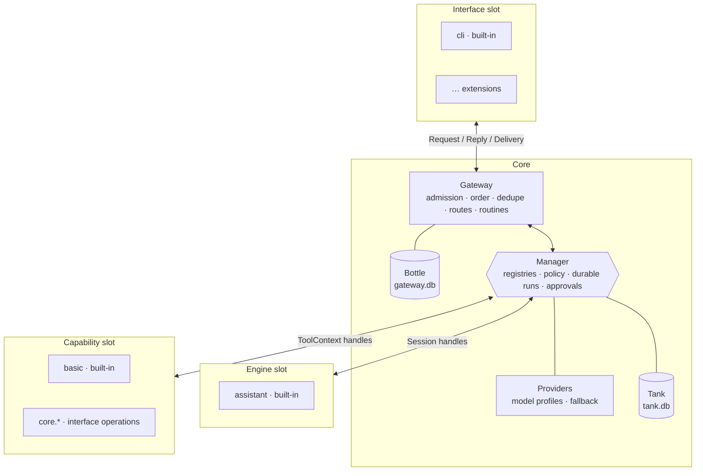
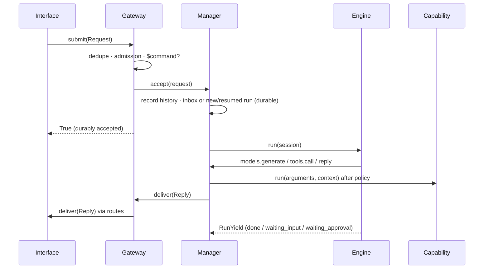

# Core architecture

The core is a small, fixed runtime. Everything that talks to a platform, decides what to say, or
does work is an extension plugged into one of three slots. The core and each extension see each
other as black boxes; the only shared code is the [`contracts`](../../contracts) package.

| Block | Does | Owns | Never |
| --- | --- | --- | --- |
| Interfaces | Platform I/O; convert events to `Request`; render `Reply`; report `Delivery` | Platform connection; its section of the bottle | Decide replies, call capabilities, read the tank |
| Gateway | Single entry; per-conversation order; duplicate drop; admission rules; `$command` detection; reply routing; routines | `gateway.db` (interface sections, seen IDs, rules, routes, routines) | Feature logic, model calls, tank access, formatting |
| Manager | Registers engines and capabilities; picks the engine per conversation; hands out handles; applies policy on every call; durable runs and approvals | `tank.db` (history, runs, events, actions, approvals, stores) | Feature logic, prompts, platform formatting |
| Engines | Turn loop through `Session` handles | Their run state (saved through the session) | Import providers, storage or interfaces; bypass policy |
| Capabilities | One action; returns `ToolResult` | Nothing durable except their extension's store | Call other capabilities or engines; talk to the user |
| Providers | Model profiles with ordered candidates and fallback; thin SDK adapters | Credentials (from environment) | Prompts, history, storage |

## Rules

1. Dependencies point inward only. `contracts` imports the standard library only; `core` imports no
   extension and no legacy package; extensions import `contracts` plus their own code.
   [`tests/test_core_boundaries.py`](../../tests/test_core_boundaries.py) enforces this.
2. Only interfaces know platform details. Platform facts travel as `Request` fields
   (`is_direct`, `mentions_me`, `display`, `extra`).
3. Only the Manager touches the tank; only the Gateway touches the bottle.
4. The Manager holds wiring and policy, never feature logic.
5. Each capability has one definition, used by `$commands` and engines alike.
6. Engines never start detached work. Autonomy comes from gateway routines.

## Request lifecycle

## Durable runs

A run is created per accepted request (or resumed for an answer). Its record, event log, engine
state, action log and approvals live in the tank. Statuses: `running`, `waiting_input`,
`waiting_approval`, `done`, `failed`, `cancelled`.

* A run holds its lane (the conversation, or with `lane: sender` the conversation plus sender for group
  messages) only while it is thinking or waiting for input. A new message goes to the newest holding
  run: into its inbox if it is thinking, as the answer if it is waiting for input. While a run waits on a
  capability or a file delivery (tracked in memory by the Manager) or for approval, it holds nothing and
  new messages start parallel runs, as in the shared room: long work never gates the conversation.
  `Session.activity()` shows each run the other open work in its conversation. Unread inbox messages
  start a new run when a run ends.
* Before a run's output is delivered, the Manager re-checks that the run is open and its assignment
  enabled, and the Gateway that the conversation is still admitted. Time spent inside interface
  deliveries (uploads, send spacing) is excluded from the run's time budget.
* On start, every `running` run is resumed with a `resumed` event. Engines replay from their saved
  state; `call_id`s make tool calls idempotent.
* The action log records each capability call as `started` before and `done` after. A repeated
  `call_id` returns the stored result. An action interrupted by a crash is re-run only if it is a
  read; prepares and writes return `uncertain_previous_attempt` and are never repeated.
* Identical prepares or writes without a `call_id` run once per run (signature deduplication).

## Policy

Assignments map address patterns to an engine, personas, `allow`/`deny`/`preapprove` capability
patterns, a budget, `trusted`, `lane`, `enabled` and engine `options`. Configured assignments can be
overridden at runtime (`core.set_assignment`, stored in the tank); requests received before a runtime
assignment was set do not start runs under it. The most specific pattern wins
(`interface:conversation`, then `interface:*`, then `*`).

* **Approvals.** A `write` capability not matched by `preapprove` creates an approval with the exact
  arguments, sends an `approval_request` notice to the control route, and returns `needs_approval`.
  `$approve <id>` by an owner executes the retained action exactly once and resumes the run with a
  `tool_result` event; `$deny` resumes it with `approval_denied`. Pending approvals survive restarts.
  Without a control route only owners can be asked (in their own conversation).
* **Owner-only** capabilities require the trigger's sender to be an owner, or a `trusted` routine.
* **Budgets** cap model calls, tool calls and active seconds per run; exceeding them fails the run.
* **Unattended runs.** Routines fire through the gateway as `origin="routine"` requests in
  `routine:<name>`; their assignment and routes decide what they may use and where results go.
  Approvals still go to the control route and the run waits durably.
* **`$commands`.** `$approve`, `$deny`, `$runs`, `$cancel`, `$tools`, `$help`, `$call` (owner runs any
  capability with JSON arguments), plus capabilities that
  declare a `command`. An owner's command counts as approval of that exact action.

## Owners and control

Owners and the control route come from `core.yml`. An interface may report the platform's own owner
(`port.set_owners`, e.g. the Discord application owner and their DM); that is used only for interfaces
with no configured owners and when no control route is configured.

## Interface reports

Besides `submit`, an interface's port can `notify` the owner (a `Reply(kind="event")` routed by
`kinds: [event]` routes or to the control route; the delivered message ID is kept as a receipt so an
owner's platform reply to it is relayed back to the origin conversation), `observe` activity into
history (idempotent per message ID), `cancel` / `cancel_all` open runs, `set_ready` (transitions notify
the owner; deliveries are refused while not ready), `check` a reply right before committing it, and read
`policy` for its conversations. `submit` returns a `SubmitResult` with the admission reason.

Revocation is immediate: a rule that stops admitting a conversation, or an assignment that is disabled
or removed, cancels the conversation's open runs and expires their approvals. Run output is delivered
only to admitted conversations, including routed targets. Owner forwards (`address → target`) relay the
owner's ordinary messages, again only to admitted targets; `core.send_message` is an explicit owner
send and is not subject to admission.

## Gateway data

* **Admission rules** per pattern: `enabled`, `allow_senders`, `require_mention_in_groups` (default
  true), `owner_only`, `max_age_s`, `commands` (`all`/`owners`). Each rule records when it last changed;
  requests received before that are not admitted, so enabling a conversation never answers backlog.
  Owners' `$commands` bypass admission. Routines are always admitted.
* **Routes** per pattern: `{target, kinds}` sends replies elsewhere (for example `routine:*` to a DM).
  Replies to `routine:*` without a route go to the control route, as does `progress` for interfaces
  whose `display.progress` is false. Routed replies carry `data["origin_address"]`.
* **Routines**: `every_minutes` or `daily_at` (local `HH:MM`). Each firing has a deterministic request
  ID, so a crash between firing and rescheduling cannot fire twice.

Config values for rules, routes and routines are written at startup; runtime edits through the
`core.*` capabilities persist for patterns not in the config.

## Files

| Path | Contents |
| --- | --- |
| [`contracts/`](../../contracts) | Public types and protocols |
| [`core/gateway/gateway.py`](../../core/gateway/gateway.py) | Gateway, ports, admission, routes, routines |
| [`core/manager/manager.py`](../../core/manager/manager.py) | Registries, runs, tools policy, approvals, commands |
| [`core/manager/handles.py`](../../core/manager/handles.py) | Session, tools, models and capability context handles |
| [`core/manager/core_capabilities.py`](../../core/manager/core_capabilities.py) | `core.*` capabilities and interface operations |
| [`core/providers/`](../../core/providers) | Profiles, fallback, OpenAI-compatible / Gemini / Anthropic adapters |
| [`core/storage/`](../../core/storage) | Tank and bottle (separate SQLite files) |
| [`core/loader.py`](../../core/loader.py), [`core/app.py`](../../core/app.py) | Extension loading and assembly |
| [`extensions/`](../../extensions) | Included: `discord` and `cli` interfaces, `assistant` engine; capabilities `basic` (time, notes), `media` (video downloads), `images` (Gemini/OpenAI), `system` (host status) |
| [`core/defaults.py`](../../core/defaults.py) | Built-in configuration for a fresh clone |

Run with `python -m core` (`--check` validates extensions and exits). Without a `core.yml` the
built-in defaults in [`core/defaults.py`](../../core/defaults.py) apply: Discord, the assistant engine and
basic capabilities, any provider with a key in `.env`. A `core.yml` is merged over the defaults; see
[`core.example.yml`](../../core.example.yml). The existing bot (`main.py`) is unchanged and does
not use the core yet; the room engine, existing features and WeChat are to be ported as extensions. Extension authors should read [EXTENSIONS.md](EXTENSIONS.md).
