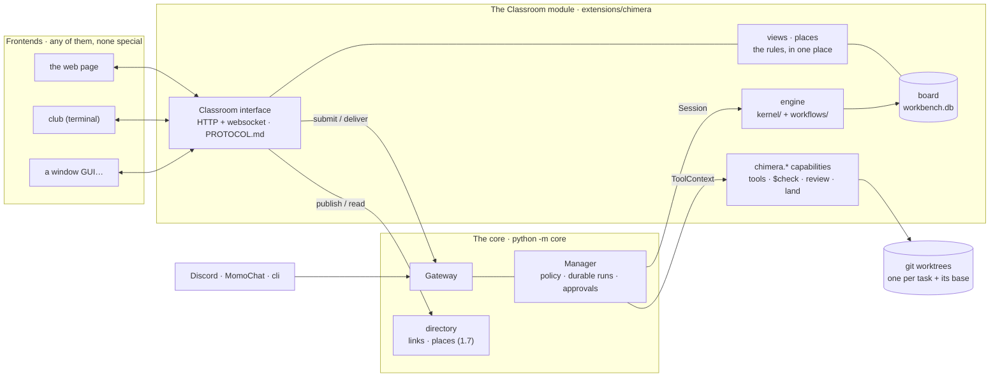
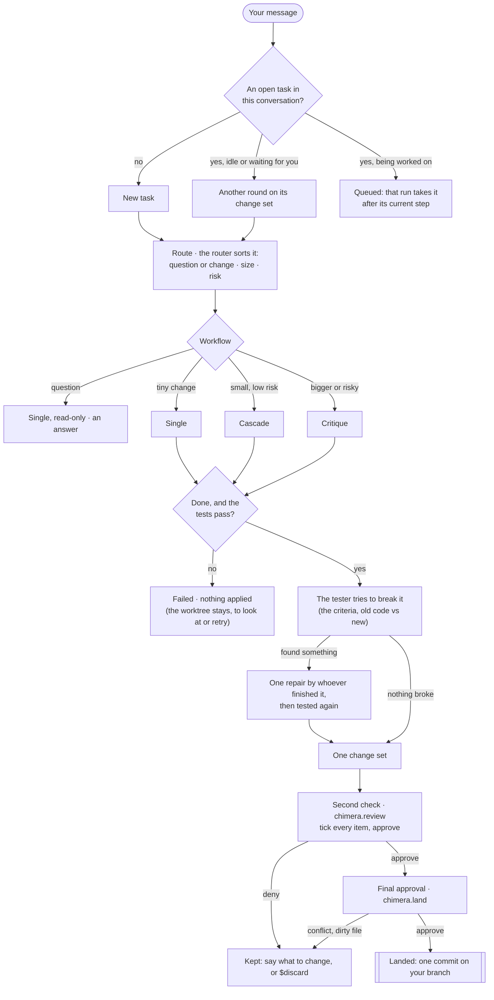
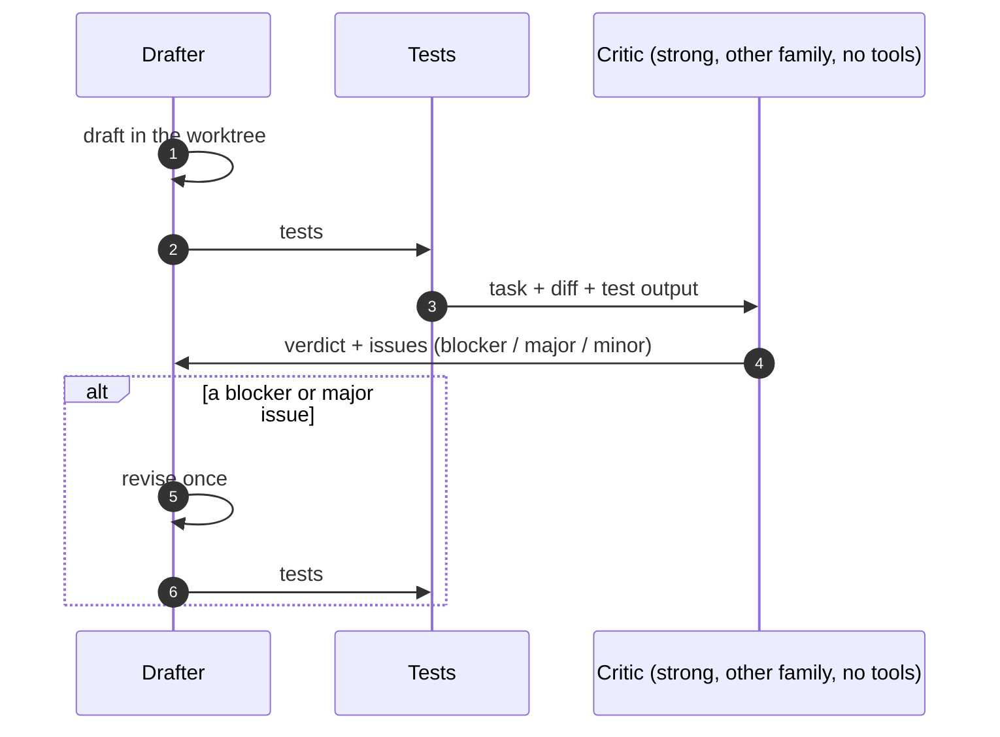
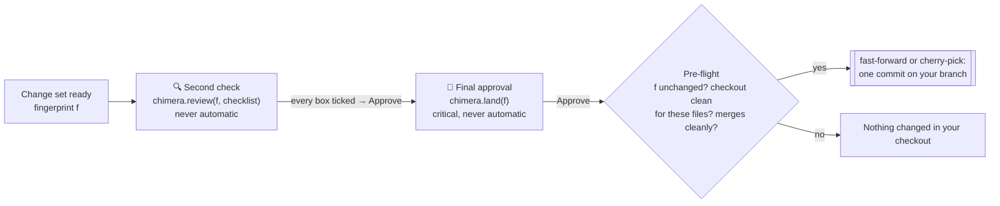

# `chimera`: the students work on your code together

Chimera is the heavy-work harness: where the students work together, used for real coding. MomoChat
([`extensions/momochat`](../momochat)) is the conversation harness; a request bigger than a conversation comes here.
It was the workbench until 2026-10-27 ([The rename](#the-rename), below); the page is still the **Classroom**.

The club takes a coding task the way GitHub's HydraFusion does. For each request it picks the simplest workflow
likely to be enough:

- **single:** one model.
- **cascade:** a cheap draft with a quality gate, escalated only if needed.
- **critique:** a draft reviewed by another model family, then revised once.
- **plan:** a strong model plans (read-only), a cheaper one carries the plan out. Chosen per task or by routing.

It works in a git worktree of the project, runs the tests, and shows you one change set. Nothing reaches your
branch until you have checked it and approved it.

What it adds to HydraFusion is that the work is visible: the classmates talk you through it ("Pro-chan drafts it,
I'll review it"), and every step shows who did it, on which model, with what tokens and time.

For whoever set it up, it is a harness. For anyone else in a Chimera conversation it is a friendly classmate with
no access to anything. From Discord it is the same harness, remotely.

## Quick start (just the Classroom, no bot needed)

1. Once: `python3 -m venv venv && venv/bin/pip install -r requirements.txt` (already done if the bot runs here).
2. Model keys: put any of `DEEPSEEK_API_KEY`, `OPENAI_API_KEY`, `GEMINI_API_KEY`, `CLAUDE_API_KEY` or
   `GROK_API_KEY` in `.env`, or point at another file with `--env`. No key? Use `--demo` (a scripted club that
   plays the practice task, with no model calls).
3. Run it and open the address it prints:

   ```bash
   venv/bin/python -m extensions.chimera --env ../.env --key DEEPSEEK_API_KEY   # or: --demo
   # [classroom] Model keys handed to the core: DEEPSEEK_API_KEY
   # [core] modules: students, chimera; interfaces: classroom; model providers with keys: deepseek
   # [classroom] Open http://192.168.1.20:4157 for the Classroom.
   ```

   This is the bot's real core (under its supervisor) with only this module and the students loaded (they are the
   seats; without mneme-llm they are not loaded and the seats are those of `team:`): it writes a small core
   configuration to `data/chimera/core/core.yml` and starts `python -m core` with it. `--env` hands every key in
   that file to the core, so every classmate with a key joins in; `--key NAME` (repeat it for more) hands only the
   keys you name, from the files or your shell. No other key, token or password of your shell reaches the core. A
   file you name with `--env` wins over the harness's own `.env`. `--also webui --also momochat` brings MomoChat
   next door too; `--core FILE` adds core settings (other modules' settings, say: its relative paths are read from
   the file's folder, its modules add to the Classroom's, and its assignments stay); `--print-config` shows what it
   would run.

On the page, pick a project (the practice project `sample` is always there), describe a task or click a
suggestion, and press Enter. When the change set is ready:

1. Tick every item on the **second check** (each file, the tests, the review notes, the commands that ran) and
   approve it.
2. Approve the **final approval**. The change becomes one commit on your branch.

Add your own projects under 📁 Projects, or in `config.yml` (copy [`config.example.yml`](config.example.yml)).

Inside the bot (`python -m core`) the module loads like any built-in one: the same page on port 4157, plus Discord
(see [From Discord](#from-discord-remote)). Turn it off with `modules: {exclude: [chimera]}` in core.yml.

## The rename

The workbench became Chimera on 2026-10-27. What was written for it keeps working (contracts 1.11):

| Was | Is | How the old one is read |
| --- | --- | --- |
| module `workbench` | `chimera` | `Extension.formerly`: `data/core/extensions/workbench/` moves to `.../chimera/`, `extension_config.workbench` and `extensions/workbench/config.yml` are read as this module's settings |
| engine `workbench` | `chimera` | `EngineSpec.formerly`: an assignment saying `engine: workbench` is this engine, and its open runs carry on |
| interface `workbench` (addresses `workbench:<task>`) | `classroom` (`interface:` changes it) | The board's tasks are readdressed on start; the core's records of old tasks keep their old address |
| capabilities `workbench.*`, profiles `workbench_<seat>_<tier>` | `chimera.*`, `chimera_<seat>_<tier>` | Not read: core.yml permission rules naming `workbench.*` need renaming |
| `python -m extensions.workbench`, `club` installed before | `python -m extensions.chimera` | `extensions/workbench/` keeps only those two commands working (it is not a module) |
| `data/workbench/` | `data/chimera/` | Used while it is the only one |
| the seats defined here (`DEFAULT_TEAM`) | the students | `team:` entries that name a student change her seat |

## From a terminal: `club`

The way `codex`, `claude` and `grok` work: run it in a project folder and talk with the club about that folder.

```bash
venv/bin/python -m extensions.chimera install --env ../.env --key DEEPSEEK_API_KEY   # once: ~/.local/bin/club
cd ~/code/my-app
club                          # talk with the club here; approvals are asked inline
club "add a --json flag"      # the same, starting with that request
club -p "fix the failing test"   # one go: work until it needs you, print the result, exit (also: club exec ...)
club -c                       # come back to this folder's open task (or take up an invitation from MomoChat)
club -C ~/code/other          # work in another folder (also -d)
club --web                    # open this folder's task in the Classroom page
club status | club stop       # the Classroom: running? projects and open tasks; stop the one club started
```

- **The folder.** club works in the git repository around the folder you are in (its root, where `AGENTS.md` is
  read). A plain folder, or a repository with no commit yet, gets a first commit only if you agree (`--yes`
  without asking). It tells you the branch, and if you have uncommitted changes: the club works from your last
  commit, and landing needs a clean checkout. The Classroom's own worktrees are refused.
- **The Classroom.** A Classroom already running is used (`--lab URL`, `CLUB_LAB`); otherwise one starts in the
  background on this computer with the keys `install` was given (log and pid in its data folder; `club stop` stops
  it). The folder becomes a project of the Classroom the first time (named after the folder).
- **Talking.** Each line starts a task, or goes to the open one as more work. The classmates' messages stream as
  they come, with each tool step (`📄 Pro-chan read file …`, `▶ … ✓`) and the tests. `/diff`, `/status`,
  `/tasks`, `/resume [id]`, `/new`, `/discard`, `/report`, `/crew names`, `/workflow name`, `/web`, `/exit`.
  Ctrl+C steps away while the club keeps working; Ctrl+D leaves. When a visit from MomoChat is over, club
  offers to report back, as the page does.
- **Approvals stay yours.** The second check lists every item; `y` shows the whole diff first (unless you just
  looked with `d`), then asks once more. The final approval and any command off the allowlist ask `y/N`.
  Typing text instead sends it as what to change. `club -p` never approves anything: it stops at your check and
  says how to come back.
- **Scripts.** `club -p --json` prints every event as a JSON line, then `{"type": "result", "status", "summary",
  "change", "tests", "link"}`. Exit code 0 for review/answered/landed, 1 otherwise, 2 for a folder it can't use.

It is a client of the Classroom protocol ([`PROTOCOL.md`](PROTOCOL.md)), like the page: it works with the page turned
off (`web: false`), and whatever it does shows in the page, and the other way round. It asks what the Classroom says (the
approval a task waits for, its checklist and ticks); it never decides that itself.

## How it fits



The module is written only against `contracts`, and it always runs in the real core: inside the bot, or as the
Classroom alone (`python -m extensions.chimera` starts the same core with just this module). Conversation traffic goes
through the core: your messages through `port.submit`, the classmates' words through `Session.reply`, approvals
through the core's approval cards, and everything you can do is also a `$command`, so Discord can do it too.

What a task looks like (steps, diffs, the approval it waits for, what can be done now) lives on the module's own
board and is computed in one place (`views.py`): the Classroom's interface serves it to every frontend through the
Classroom protocol ([`PROTOCOL.md`](PROTOCOL.md)), so the page, `club` and a window GUI show the same rules instead of
deciding them. The Classroom tells other interfaces where it is and who is in it through the core's directory (contracts
1.7), which is how MomoChat draws it on its map without knowing anything about it.

## A task's life



## The three workflows

| Workflow | Picked for | Steps |
| --- | --- | --- |
| **single** | a question (read-only), or a tiny change | one classmate does it → tests |
| **cascade** | a small, low-risk change | cheap draft → tests → cheap judge from another family → accepted, or a strong classmate takes over → tests |
| **critique** | a medium or large change, or a risky one | draft → tests → critic (strong, another family, **no tools**) → approved, or the drafter revises once → tests |
| **plan** | only when chosen (or routed to it in `config.yml`) | planner (strong, read-only) writes the plan → the drafter carries it out → tests |

```mermaid
sequenceDiagram
    autonumber
    participant Y as You
    participant R as Router (GPT)
    participant D as Drafter (cheap)
    participant T as Tests
    participant J as Judge (other family)
    participant S as Strong
    Y->>R: "Sunday sorts first; fix it and add a test"
    R->>Y: "DeepSeek drafts it, Gemini checks it, Claude steps in only if needed."
    D->>D: read · search · edit · run (in the worktree)
    D->>T: the project's tests
    alt the tests pass
        T->>J: task + diff + test output
        J->>R: approve, or revise with issues
    end
    opt unfinished, tests fail, or the judge says revise
        R->>S: take over (the draft, its diff, why it did not pass)
        S->>T: the tests again
    end
    R->>Y: one change set + the second check
```



Effort follows HydraFusion's latest setting: drafts at medium, reviews and judging at high, routing at low.

## Two approvals (the second check)



- **The second check** is the extra layer for testing. Its card lists every changed file, the test result, the
  reviewer's notes, the criteria met, what the tester tried (and each problem she still sees), the commands that
  ran and the summary. Every item must be ticked before the approval counts, and the Classroom itself enforces it
  (the `chimera.review` capability), whatever the interface: on the page with the boxes, anywhere with
  `$check [task] all` or `$check 1 3 4` after looking. Approving with items unticked gets "not yet" and a new
  request; the ticks you made stay. From Discord the diff arrives as a file with a link to the page.
  `second_approval: false` removes the layer, leaving only the final approval.
- **The final approval** lands the change. You can also type `$land` (it asks to confirm). Both check that the
  change set is the one you checked (by fingerprint). A newer message in the task makes older cards stale.
- **Mid-work approvals:** a shell line off the allowlist waits for you. The allowlist covers tests, linters,
  builds and looking around, and never anything that names paths outside the worktree or secrets. Reads and edits
  in the worktree never ask.
- **Fail-safe:** if the work fails, is cancelled, or doesn't pass its tests, nothing is applied. The worktree stays
  so you can look, retry or `$discard`. If landing finds a conflict or a dirty file, it stops before touching your
  checkout.

## Routing

A cheap router call sorts the request into kind (question or change), size (tiny, small, medium, large) and risk.
If no model answers, keywords decide instead. Simple rules then pick the workflow:

| Signals | Workflow |
| --- | --- |
| question | single (read-only; a strong classmate if it is large) |
| change, tiny, low risk | single |
| change, small, low risk | cascade |
| change, medium or large, or high risk | critique (a strong drafter when large or risky) |

On the page you can override it per task (Auto · Single · Cascade · Critique, and any workflow you add), with
`club --workflow`, or point the rules at another workflow in `config.yml`: `routing: {small: critique}` (keys:
question, tiny, small, medium, large, risky). Every decision and every result goes into `outcomes.jsonl`: routed,
escalated, ready, checked, landed, discarded, failed, with the tokens used. That log is the evidence for tuning the
rules later on your own use, where HydraFusion tuned on benchmarks.

## Changing how it works

You don't have to agree with the club's reasoning. What you can change, from the smallest step to the largest:

| You want | Do |
| --- | --- |
| Other classmates, models, role orders | `config.yml`: `team:`, `roles:` (see [`config.example.yml`](config.example.yml)) |
| Other routing | `config.yml`: `routing:` points a case at any workflow |
| Another way of working | Drop a file into [`workflows/`](workflows): `@workflow("name", "Title", "what it does")` on an `async def run(round)`; it is listed in the page and `club` and can be routed to. The built-in `single`, `cascade` and `critique` are files there too, and the toolkit (`round.solve`, `review_change`, `validate`, `diff`, `outcome`, `say`, the journal) is documented in [`workflows/__init__.py`](workflows/__init__.py). Whatever it returns is verified the same way afterwards. |
| Another verification | `config.yml`: `verify: {requirements, probe, repairs}`; the stage itself is [`kernel/verify.py`](kernel/verify.py) |
| Another frontend | Speak the Classroom protocol ([`PROTOCOL.md`](PROTOCOL.md)), as the page and `club` do; or set `web: false` and keep only the API |
| A whole other engine | Assign your own engine to `classroom:*` (core.yml `assignments:`); the capabilities and the page stay |

## Verification: the harness looks for the bugs, not you

A reviewer that only reads a diff misses things, and a person should not have to find them. So every change,
whatever workflow made it, goes through the same checks before it comes to you ([`kernel/verify.py`](kernel/verify.py)):

1. **Acceptance criteria.** At the start of a round, the request becomes a short list of checkable criteria
   (`behavior`, `keep` for "keep X unchanged", `tests`, `docs`), kept with the task and extended by follow-ups. The
   drafter reads them in her brief.
2. **Reviews that follow them.** The judge and the critic say per criterion whether it is met (with the evidence)
   and list every change no criterion asks for. A criterion not met, a change nobody asked for, or a correctness,
   requirement or scope issue of *any* severity blocks: a "minor" bug is still a bug.
3. **The tester.** A classmate (another than the one who wrote it where possible) tries to break the change. She
   writes probe inputs into `.probe/` (never part of the change set) and runs `probe`: the same line on the new
   code and on a pristine copy of the base commit, so "keep it unchanged" is checked by running it. What she shows
   with a probe is a finding.
4. **One repair.** Findings go back to whoever finished the change, then the tester looks again (`repairs`, 1).
   Whatever is still found comes to you as a warning and a checklist item per problem, never silently.

`verify: {probe: auto}` tests every change but a tiny one (or any with a "keep" criterion); `true` always, `false`
never. The tester's turns are `turns: {probe: 10}`.

## The club: seats and roles

A **seat** is a classmate with a model family and two model lists (`cheap`, `strong`). A **role** is an ordered
list of seats; the first seat that can answer takes it. Reviewers (judge, critic) come from **another family**
than the drafter when one can answer, otherwise from another seat.

**The seats are the students.** The module declares `uses=("students",)` and reads the agents loaded before it
(`context.personas()`, contracts 1.11): each student of the students module is a seat, on her `own` tier for cheap
work (her own models, nobody else's as a fallback) and her `strong` tier for strong work (GPT on GPT-6.1 Sol, Claude
on Sonnet; the others on their own models), from her model's family, saying who she is with her `description`.
Nothing about the five is written here. `team:` in this module's config.yml changes a seat key by key (`effort`,
`tool_calls`, `voice`, `cheap`, `strong`, `family`, ...), removes one (`gpt: false`; a student is found by her other
names too, so `luna: false` removes GPT), or adds a seat of its own with its models (`flash`, `pro`: an agent this
module adds, with no memory). A role naming a student by another name (`luna`) names her. Without the students
module (or mneme-llm), the seats are only those of `team:`, and with none the Classroom suggests no assignment
(`no_seats` in the audit log).

| Role | Default order | Tier |
| --- | --- | --- |
| router (sorts, announces) | GPT, Claude, Gemini, DeepSeek, Grok | cheap |
| drafter | DeepSeek, Gemini, Grok, GPT, Claude | cheap |
| judge (cascade) | Gemini, GPT, DeepSeek, Claude, Grok | cheap |
| strong (takes over) | Claude, GPT, Gemini, DeepSeek, Grok | strong |
| critic (critique) | Claude, GPT, Gemini, DeepSeek, Grok | strong |

Seats without a key are left out quietly (the engine asks the core, contracts 1.6). When a role's list runs out,
its sibling role steps in (strong ↔ drafter, judge ↔ critic), then anyone else in the club; a reviewer is never the
drafter herself (an unreviewed change, marked as such, comes to you instead). If a seat fails mid-task, the next
one takes over and the club says so. An answer cut off at the length limit is asked again once with twice the room
(`max_tokens_cap`, 32000) and an instruction to do less per turn; only a second cut-off counts as stuck. Each seat
has its own model profile (`chimera_<seat>_<tier>`) holding only her own models, so a silent fallback never
changes a reviewer's family. The ledger shows the provider that actually answered.

**The crew.** Who comes along to a task: picked on the arrival card (the inviting classmate's `companions` by
default) or in the composer, and for `club` with `--crew`/`/crew`. The crew take their roles first, in each
role's order; the classmate who brought you leads and keeps her usual roles. Nobody picked: the usual order. The
page shows who has no key (as the latest run could tell; inside the bot that is known from the first run on).

Two seats can share a family, for example two DeepSeek models as two classmates (see
[`config.example.yml`](config.example.yml), `flash` and `pro`).

## MomoChat and the Classroom

Two places, one club (the Codex route: chat and work are separate places that remember each other):

- **MomoChat** is the web UI on :4156, chatting with the students (the momochat engine). The web UI also has the
  **Cafe**.
- **The Classroom** is this page on :4157, sessions of work on your projects (the chimera engine; a session is a
  task). Its other view is the **Logbook** page (`#logbook`): what was spent each day of the last two weeks, by student
  (the core's spending history, `/api/logbook`), each student's share, and every past session; `#students` still
  opens the seats. The header shows the day's stamina for everyone together (the core's), each seat her own. The
  **Students** page is the web UI's: it shows each student's record here from the facts this module publishes.

**Each student's record, as facts** ([`record.py`](record.py)). The module publishes, for every seat, everyone who
worked a session and every student in a measured team: `chimera.record` (the sessions she worked in by how they
ended: `landed`, `discarded`, `open`; her `level`, 1 + landed // 3, how far `toward` the next, and her art `stage`,
which opens at levels 1, 10, 20 and 30) and `chimera.benchmark` (the measured teams she was in: her seats, her model,
the team's points, fully solved exercises, cost a session off-peak and at peak, median time and her share of the
cost). They are written at start and again whenever a session lands or is discarded. The measured teams come from
[`benchmarks/`](benchmarks) (`polyglot.json`, the round of 2026-10-25, made by `experiments/polyglot/export_benchmark.py`
outside this repository); another round is another file there.

Each page publishes its views in its directory status (`views`: name, icon, a path relative to its link, `order`),
and every page draws one places bar from them (`static/places.js`). A student is in every place at once: the maps
never take her out of one place while she works in another. The Classroom opens on its **sessions**: one card each
(open ones first), with its status, the team on bookmark portraits (who held which seat, `lineup`), what it cost and
how long it took. The page comes with its first hello inside (`{{state}}`), so the cards are there on the first paint.

**A new session picks its team.** **New session** opens the team picker: the work (what to do, the project), the
**formation** (Alone: one builder, the `single` workflow; Plan → build: a planner and a builder, `plan`; Draft →
judge: a drafter, a judge and one who takes over, `cascade`), the **tester seat** (on or off for this session, over
`verify: probe`), a student for each seat (her bookmark, her level, her model: her own or her strong one where she has
one), and **This team**: the measured results when this exact team was benchmarked (`benchmarks/`), your sessions
with it, the session's **budget**, the cheapest and the most-solved measured teams, and peak or off-peak prices.
Starting sends the team with the task (`team`: `{formation, seats, tiers, tester, budget}`, checked against the
formation's roles and the seats): the engine seats the picked classmate first in her role whatever her family (never
as her own reviewer), on the picked model, and runs the tester only when the seat is on.

**After a session, its report.** A session waiting for you or done opens on its report: what each student said, the
signals that need no answer key (the project's tests, the tester, not stuck, confined), the change (its files, the
diff a click away), what it took (time, cost and the peak price, the budget, each student's calls, tokens and cost,
the share from the cache) and **your call**: the second check and the final approval as their cards (every box
ticked first), send back with a note (another round on the same change set), or discard. Landing counts toward the
next level of everyone who worked on it. "See the whole session" opens the timeline and the inspector, as a session
at work shows.

What the characters say still uses the old names ("the lab" for the Classroom, "the classroom" for MomoChat), since
that wording is part of their prompts; renaming it is proposed separately.

```mermaid
sequenceDiagram
    autonumber
    participant Y as You
    participant C as MomoChat
    participant L as Classroom (chimera)
    Y->>C: "the schedule lists Sunday first; can you fix it?"
    C->>C: DeepSeek checks the task log (chimera.tasks)
    C->>Y: "I think we need to go to the lab for this, want to come with me?"
    C->>L: chimera.invite: her brief, her notes on how you like it,<br/>the latest part of this chat (nothing starts)
    C->>Y: a link · on the map she has a ticket for you (still in class)
    Y->>L: follow it: the arrival card (the brief to edit, project, workflow, who comes along)
    Y->>L: Start the session
    L->>Y: "Here we are in the lab. I brought what we talked about." · the work · two approvals · landed
    Y->>L: Report back
    L->>C: a session report in the same chat (core.send_message, your own command)
    Y->>C: the conversation goes on, and the students know what happened
```

**What travels, and how the club remembers.**

| | How |
| --- | --- |
| MomoChat → Classroom | `chimera.invite` (offered to the students while the creator talks, wherever they are): her `brief` (what to do, every decision and name from the chat), her `notes` (what she knows about how you like such work, from her diary), her `companions` (students she asks along; one not in the Classroom's team or without a key is named in the result and stays behind), and the chat's latest messages (`bring_messages`, 16), read through the conversation's history (contracts 1.6). It only makes an invitation and returns a link; following it is accepting, and you start the session on the arrival card (or with `club -c`), where you can still edit the brief and who comes. |
| In the Classroom | The student who invited you leads: she greets you and speaks for the club in that session (a Classroom seat stands for a MomoChat persona with `also:`, as Flash-chan does for DeepSeek). Every round's brief carries what came from MomoChat and the project's **notebook** (what the club did there before). |
| Classroom → MomoChat | **Report back** (on the page, or `club`, once the session is done): a session report (title, outcome, commit, tests, who did it, who was in the Classroom and who was asked along but not there, the summary, a link to the visit) goes into the chat it came from, sent with `core.send_message` as your own command. It joins that chat's history, so the students there know it, and it can go into their diaries like anything said there. |
| MomoChat → Classroom, later | The **task log** (`chimera.tasks`, `$tasks <words>`; not the Logbook page): the students look up what happened in the Classroom; DeepSeek does before she writes a new brief. |

**The mini map**, in both places: MomoChat and the Classroom side by side, and who is in each. A **visit** lasts from
the start of a session until you report back or it is closed (or `visit_minutes`, 30, after it last moved once
nothing runs): the student who brought you, her crew and everyone who worked on it are in the Classroom meanwhile,
at work or "waiting for your check"; they stay in MomoChat too. An invitation you have not followed yet keeps her
in class with a pulsing ring, and its ticket waits in the corridor (🎟️🚪); click a place (or the ticket) to go
there.
The Classroom serves it at `/api/presence`; the web UI's server asks for it on this machine every few seconds while
a page is open (web UI setting `lab_presence`), so neither page reaches across sites.

Settings (`config.yml`; the keys keep their first names): `classroom_url` (where "open MomoChat" goes; default the
same computer, port 4156), `bring_messages` (16), `visit_minutes` (30), and per seat `also: [MomoChat persona, ...]`.

## The project's own instructions

Like Codex, Grok and Claude Code, the club reads the instructions a project keeps for coding agents: `AGENTS.md`
and `CLAUDE.md` at the root of its checkout (the owner's committed words, never a draft's edits), 32 KiB at most
together, a second file left out when it says the same. They go into every brief, and the judge and the critic
get them too, so a review checks the change against the project's rules.

## Cost

Every model call is logged with its seat, model, tokens and seconds. The prices come from the core (contracts 1.12,
[`core/providers/prices.py`](../../core/providers/prices.py)): every answer arrives priced, for every engine, and
this module keeps each step's price and shows them. The core's list is **Artificial Analysis**'s free models list,
under your own figures in core.yml's `prices:`: a free key from artificialanalysis.ai, as `ARTIFICIAL_ANALYSIS_API_KEY` or `AA_API_TOKEN` in
`.env`. Inside the bot, `python -m core setup` asks for it. See [Prices and
stamina](../../docs/core/EXTENSIONS.md#prices-and-stamina).

- The list is fetched again once the kept list (`prices.json`, in the core's data folder) is more than 24 hours old:
  by the core in the background whenever a model is called, and by the Classroom when a task starts. A failed fetch
  keeps the last good list and tries again an hour later; it never holds a task up.
- Each answer is priced when it comes and the price is kept with it, so a later list never rewrites what a past
  step cost. The ledger (Steps & cost) shows each call's price and its source, and the task's total.
- Models are matched to the list by name: exact, the same words in another order, else the one closest model of
  the same maker. A tie is never guessed. The club dialog shows the candidates; name one under `prices: aliases:` in
  core.yml. Your own `prices: models:` there win over the list.
- These are list prices; cache hits count at the listed cache price where there is one, else at the input price.
  The page credits Artificial Analysis wherever its prices appear, as their terms ask.

## From Discord (remote)

Inside the bot, assign a Discord channel to Chimera. Every message there becomes a task in its own thread;
replies in the thread are follow-ups, and approvals reach your DM with buttons. In `core.yml`:

```yaml
assignments:
  "discord:123456789012345678":            # a channel for tasks
    engine: chimera
    personas: [gpt, claude, deepseek, gemini, grok]    # the seats you use (flash, pro, …)
    budget: {model_calls: 120, tool_calls: 400, seconds: 3600}
    options: {project: harness}             # its project (or start a message with "harness: …")
admission:
  "discord:123456789012345678": {require_mention_in_groups: false, owner_only: true}
extension_config:
  discord: {thread_channels: ["123456789012345678"]}
```

The page shows those tasks live too, marked "from discord". In the task's conversation, `$land` and `$discard`
act on its open task, and `$tasks` and `$projects` list what there is. Anyone other than you gets a friendly answer
and no access to any project, as everything that touches the computer is creator-only.

## How it works

| File | Role |
| --- | --- |
| [`extension.py`](extension.py) | `EXTENSION`; `assemble` builds the board, projects, worktrees, team, engine, capabilities and page, and suggests the `classroom:*` assignment, admission, providers, profiles and default classmates |
| [`engine.py`](engine.py) | `ChimeraEngine`: the creator's messages go to the flow, anyone else's to a short chat |
| [`kernel/flow.py`](kernel/flow.py) | A task's life: which task, routing, the round's toolkit for workflows, presenting, two approvals, landing |
| [`workflows/`](workflows) | One file per way of working (`single`, `cascade`, `critique`); drop one in to add one |
| [`kernel/verify.py`](kernel/verify.py) | Acceptance criteria, the tester (probes on the old code and the new), one repair |
| [`kernel/context.py`](kernel/context.py) | The run's journal and its only doors to models, tools, speech and the board |
| [`kernel/agent.py`](kernel/agent.py) | The solver: turn by turn with the tools (JSON turns: say, note, plan, actions, status, summary) |
| [`kernel/review.py`](kernel/review.py) | Critic and judge: no tools, a structured verdict |
| [`kernel/router.py`](kernel/router.py) | Signals (model or keywords) and the rules |
| [`kernel/prompts.py`](kernel/prompts.py) | Every prompt and schema, and the club's own lines in English and Chinese |
| [`team.py`](team.py) | Seats, families, roles, the per-seat profiles |
| [`capabilities.py`](capabilities.py) | `chimera.*`: open, list, read, search, write, edit, delete, run, probe_file, probe, test, diff, check, review, land, discard, tasks, projects, invite |
| [`views.py`](views.py), [`places.py`](places.py) | The rules the frontends show: a task's current approval with its checklist, its actions, the report; the Classroom as a place |
| [`workspace/`](workspace) | `worktree.py` (open, change set, land, remove), `tools.py`, `commands.py` (the allowlist), `projects.py`, `git.py` |
| [`web/server.py`](web/server.py) | The Classroom's interface: the API ([`PROTOCOL.md`](PROTOCOL.md)), the page unless `web: false`, the place published in the core's directory |
| [`board.py`](board.py) | Tasks, steps (with each model call's seat, model, tokens, cost, time), the page's transcript, outcomes |
| [`web/static/`](web/static) | The page (app, styles, a copy of the web UI's Markdown renderer) |
| [`demo.py`](demo.py) | The scripted club behind `--demo` (a provider kind the module adds) |
| [`cli.py`](cli.py), [`__main__.py`](__main__.py) | `club`; the Classroom alone on the real core |
| [`sample/`](sample) | The practice project, copied into the data folder on first use |

### Durable, by replay

The engine is run again from the top after every restart and every approval, as the core does with every engine.
Each step that costs or changes something is kept in the run's state under a key computed the same way each time,
so a replay returns the kept result instead of repeating it:

| Key | Kept |
| --- | --- |
| `r1.route.<seat>` | the router's answer |
| `r1.draft.2.m` | turn 2's model answer (and `r1.draft.seat`: who answered, so a replay keeps her) |
| `r1.draft.2.a0` | its first action's result (`call_id` = the key; the core's action log agrees) |
| `r1.draft.2.say` | that she said it (said once, never twice) |
| `r1.check.ask` | the second check: waiting, until the decision arrives as a `tool_result` event |

The workflows therefore read as plain sequential code and still survive a restart, or a wait of days for an
approval. A newer message can take a task over while an older run waits. The older run then notices it no longer
owns the task and says its approval was for an older version.

### Safety, kept small

Security is not the focus yet. What is there:

- The page answers only private networks (and Tailscale's range) and refuses other sites (Host and Origin checks).
- Everything is creator-only.
- Paths stay inside the task's folder.
- Shell lines run without the model keys in their environment, and lines off the allowlist ask.
- On Linux, two settings confine what those lines (the club's commands, probes and the tests) can reach:
  - `command_network: false` takes the network away;
  - `command_filesystem: worktree` runs them in a bubblewrap sandbox. They see the system read-only, their
    worktree and the project's checkout. Home and temp folders (your `.env`, other worktrees, the Classroom's data) and
    other processes are not there.

  Off by default. Where they cannot be had, the commands are refused, never run without them. Turned on after
  models in a benchmark went looking for the hidden tests, on GitHub and on the disk.
- The core blanks known secret values out of tool results and messages.
- Landing is the only write to your checkout, behind two approvals.

## Data it keeps

Under its data folder: `data/chimera/` for the Classroom alone (`data_dir`; the core's own stores in `core/` there;
`data/workbench/` when only that one exists), `data/core/extensions/chimera/` in the bot. The board's file keeps its
name, `workbench.db`, so the labs and data folders made before the rename open as they are.

| Path | Contents |
| --- | --- |
| `workbench.db` | Tasks, steps, the page's transcript, projects added in the page |
| `outcomes.jsonl` | One line per routing decision and result, for tuning the router |
| `worktrees/<task>` | Each open task's worktree, and `<task>.base` for the tester's probes (removed when it lands or is discarded) |
| `patches/<task>.diff` | The last change set of a landed or discarded task |
| `sample/` | The practice project |
| `host.db`, `host.log` | On its own only: runs, events, approvals, the action log; and an audit log |

## Live results so far

DeepSeek only (Pro-chan drafting, Flash-chan routing, judging and reviewing), on the practice project:

| Task | Workflow | Result | Calls | Tokens | Time |
| --- | --- | --- | --- | --- | --- |
| Sunday sorts first: fix it, add a test | cascade | right fix + regression test; judge approved; landed | 5 | 12k | 40 s |
| What does `next_meeting` do on an empty schedule? | single, read-only | correct (`min()` raises `ValueError`, line cited) | 4 | 7k | 31 s |
| Add `--json` to `list`, with a test | critique (forced) | done; the critic approved with real minor notes (e.g. `--json` silently ignored by `next`); landed | 5 | 17k | 75 s |

## Tests

[`tests/test_chimera.py`](../../tests/test_chimera.py), with scripted models and real git, every flow in the real
core (the Classroom alone, as `python -m extensions.chimera` runs it):

- the allowlist, test detection and path refusals
- landing by fast-forward and by cherry-pick onto a branch that moved, and stopping on a dirty file or a conflict
  with nothing changed
- the cascade escalating failing tests and landing after two approvals, with the outcomes log
- a read-only question, and a critique revising once after a blocker from another family
- failing tests applying nothing; a command off the allowlist waiting for approval and the run resuming
- a denied second check, a follow-up round, and feedback taken in the same run
- a task surviving a restart, with nothing said twice, and a guest getting chat only
- the page refusing other sites and starting a task
- the module inside the real core, from its page and from another interface (diff file, link, approvals there)
- the MomoChat → Classroom trip: an invitation with companions, the visit on the map, report back, the logbook
- the crew taking roles first; the narrator speaking of her own part in the first person; `AGENTS.md` reaching
  the drafter and the judge
- an answer cut off at the length limit asked again with twice the room; seats without a key skipped quietly
  and a sibling role stepping in
- `club`: a folder made a repository only with consent (a subfolder means its repository), and one go from a
  folder through the real page websocket, stopping at your check
- the second check enforced by the Classroom: an approval with items unticked gets "not yet" and a new request; `$check`
  from another interface; the Classroom's view of which approval is for now (and `club` asking only that)
- verification: the criteria in the drafter's and the reviewer's prompts; a "minor" bug or an unasked change still
  blocking; the tester's finding repaired and tested again; a problem still found reaching the checklist; a probe
  on the old code and the new, with `.probe/` never in the change set
- a workflow added to the registry and routed to by `routing:`; the API serving with the page turned off

```bash
venv/bin/python -m unittest tests.test_chimera
```

## Next

- Replies in the person's language: see the proposal in the project notes (a computed language per turn).
- Tune the routing from `outcomes.jsonl` once there is real use, as the earlier plan proposed.
- Give the critic read-only tools: HydraFusion's latest critics inspect the workspace.
- A page for chat and tasks together: MomoChat with a Tasks tab.
- Parallel critics, and HydraFusion's "Max" (higher effort where it matters).
