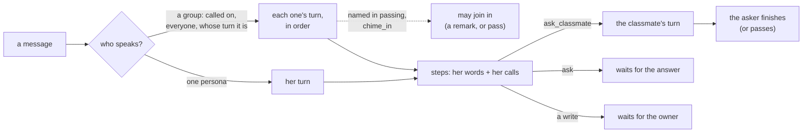

# `momochat`: the conversation harness

MomoChat is the general assistant: conversations, direct chats and group chats, tools and commands. Talking with a
student here is the companion experience (she has her memory of you wherever she speaks); talking with an agent is a
plain assistant. Chimera ([`extensions/chimera`](../chimera)) is the heavy-work harness: a request bigger than a
conversation goes there (`chimera.invite`). See [docs/DESIGN.md](../../docs/DESIGN.md) for how the two divide the work.

Until 2026-10-27 this was three engines: the assistant (one persona, tools, questions), the room (group chats) and
Whale-chan's chat engine (a personal AI chat client). Their names, `assistant`, `room` and `chat`, are this engine's
former names, and the assistant's and the room's module names this module's, so nothing written for them needs
changing ([Former names](#former-names), below).

## What it adds

| Kind | Name | Details |
| --- | --- | --- |
| Engine | `momochat` | Persona mode `many` (one or several). Formerly `assistant`, `chat`, `room` |
| Declares | `formerly=("assistant", "room")` | Their settings and stores are this module's (contracts 1.11) |
| Settings | `max_steps`, `history_limit`, `effort`, `style`, `chime_in`, `compact`, `tool_calls` | Offered by `python -m core setup`; the rest are in [`config.example.yml`](config.example.yml) |

It adds no interfaces, personas, profiles or capabilities. The core's default assignments (`*`, `routine:*`) give it
the core's own `assistant` agent; the web UI and Whale-chan's bot assign it with the students.

## How a message is answered



**Who speaks.** In a direct chat (one persona) she does. In a group chat (several): those the message calls on
("Luna, …", "…, Luna?", "@Luna"; her name, display name or other names), everyone for "you all", "大家" and the like,
or, when it names no one, whose turn it is (a rotation kept per conversation). Someone named only in passing ("Luna,
what did DeepSeek and I do?") may add her word after the answer, or pass; with `chime_in`, after whose turn it was,
the others may too. Joining in is one short remark or `pass`: no tools, questions or hand-offs.

**One turn for every speaker.** Each step is her words and her calls. Where her model can call tools as functions
(OpenAI-compatible providers; `tool_calls` on by default) it does; otherwise, and for a closing step or a speak-up,
it answers one JSON object `{message, status, actions}`. The transcript keeps both forms, so a step falls back from
one to the other. Invalid steps get corrections; in a group, a speaker whose steps keep failing says so, in the
person's language, and the others go on. Besides the core's tools (under its policy) she has the engine's own:

| Tool | What it does |
| --- | --- |
| `ask` | One question to the person, alone: the run waits for the answer (`WAIT_INPUT`) and she goes on with it |
| `pass` | Stay silent: only when she was invited to join in |
| `ask_classmate` | The hand-off, in a group chat: `{classmate, request}`. The classmate takes a turn of her own right after, with the request and her own tools ("search this for me", "draw this with image-2.5-Sunburst", "write this prompt"), and answers in the chat; then the asker gets a short turn to finish with her answer, or pass. At most `max_handoffs` (3) per message; a name nobody in the chat has is told so |

Actions run in order with saved call ids (`m1`, `m2`, …), so a restart never runs one twice; a batch stops at the
first failure or refusal; files from successful results are delivered; a write that needs the owner's approval
waits durably, and the run resumes with the result. Each speaker has `max_steps` steps (8); when they run out, one
closing step says what is done and what is not. `max_turns` (12) bounds the turns of one message.

**What she reads.** Her system prompt is her prompt, her display name, her stable prompt parts, the conversation's
`instructions` (and `owner_instructions`, when an owner speaks), the contract of her style, and in a group the roster
and the group's rules. Then the conversation: the thread since the last `/new`, its last `history_limit` messages
(30) word for word (at most `history_chars` characters of them, when set; a second is never split), older ones as the
conversation's rolling summary (rewritten by one `compact_profile` call once `compact_every`, 20, have scrolled
out; `core.search_history` finds their words), with `$commands` and their answers left out. Then the turn's context:
the time, her turn parts (a student's memory of the person, from the students module: her notes and her first look
at what was said before), other requests in progress, what was said in this run before her, and why she speaks if
nobody asked her. Then the message and her turn so far. Her prompt parts are rendered once at the start of her turn
(`session.aprompt`, contracts 1.14: a part may look something up), and kept for its every step. The tools she is
offered are the ones for her turn (`tools.list(persona)`), and her calls say it is hers (a student's search through
her memory).
Images attached to the run's messages, sent shortly before (`history_image_minutes`, 30) or found by tools are shown
on every step. The system prompt and the conversation stay the same prefix from step to step, so the provider's
prompt cache serves them.

**Two styles.** `brief` (the default): she speaks as she goes, briefly, in her own voice, quoting the message in a
group. `full`: a personal AI chat client (Whale-chan's bot): complete answers in Markdown and LaTeX, her notes while
she works shown as progress, and only the answer posted.

**Threads.** `/new` (or `/reset`, `/clear`) starts a fresh thread in that conversation (`new_chat_text` answers):
earlier messages stay in history but are no longer read, and the summary of before is set aside.

**Her own impulse.** A request an interface marks `extra.speak_up` (Whale-chan's bot speaking up; its text starts
`⟨speak-up⟩ `, which history shows as her own impulse) is her own wish to message someone: one step from the motive,
no tools.

**It keeps nothing of people.** No core diary: a student's memory is the students module's (its prompt part and its
watcher, which learns from what she says here), and an agent has none. An assignment's old `diary: true` does
nothing.

## Setup

The module loads by default. Its settings are in `extensions/momochat/config.yml` (git-ignored; copy
[`config.example.yml`](config.example.yml)); `extension_config.momochat` in core.yml is merged over it. Each is the
default of the assignment option of the same name, which wins:

| Key | Default | Meaning |
| --- | --- | --- |
| `style` | `brief` | `brief` or `full` (above) |
| `effort` | `low` | Reasoning effort of each step: `low`, `medium`, `high` |
| `max_steps` | 8 | Steps (tool rounds) of one speaker per message |
| `max_turns` | 12 | Speakers' turns per message, hand-offs and follow-ups included |
| `max_handoffs` | 3 | Hand-offs per message (0: none) |
| `max_tokens` | 1500 | Output tokens of each step |
| `timeout_s` | 35 | Seconds a model call may take |
| `tool_calls` | true | Function calls where the model can make them (false: JSON steps only) |
| `history_limit` | 30 | Messages read word for word (at most 150) |
| `history_chars` | 0 | At most this many characters of them (0: no budget) |
| `compact` | true | Fold older messages into the conversation's rolling summary |
| `compact_every` | 20 | Fold once this many have scrolled out |
| `compact_profile` | `default` | The model profile that writes the summary |
| `chime_in` | false | A group message naming no one: whose turn it is answers, the others may join in |
| `new_chat_text` | `New chat started.` | The answer to `/new` |
| `aliases` | `{}` | More names that call on a persona in a group, beyond her own `aliases` |

Assignment options besides these: `instructions`, `owner_instructions`, `history_scope: sender` (in a group, only
this person's messages and the replies to them), `history_image_minutes`, `quote: latest` (the default) or `trigger`.

```yaml
assignments:
  "discord:123456789012345678":            # a channel where the students talk
    engine: momochat
    personas: [gpt, gemini, claude, deepseek, grok]
    budget: {model_calls: 40, tool_calls: 24, seconds: 900}
    options: {chime_in: true, history_limit: 40}
  "discord:dm:*":
    engine: momochat
    personas: [deepseek]
    options: {style: full, effort: high}
```

A busy group chat makes many model calls: give its assignment a larger `budget`.

## Former names

| Was | Is now |
| --- | --- |
| engine `assistant` (one persona), module `assistant` | `momochat` with one persona, `style: brief` |
| engine `room` (group chats on a work board), module `room` | `momochat` with several personas. The work board's `jobs` are hand-offs now (`ask_classmate`), one at a time; `work_note` is gone |
| engine `chat` (Whale-chan's plugin) | `momochat` with `style: full`, her old settings as her assignment's options |
| `diary` (the core diary, in all three) | nothing: a student's memory is the students module's |

core.yml lines saying `engine: room` (or `assistant`, `chat`) reach MomoChat, and the audit log says
`engine_renamed_in_config` until you rename them; runtime assignments are rewritten; open runs of the old engines
carry on here (`engine_runs_moved`). A run another engine saved is answered afresh, from its message. The room's and
the assistant's `config.yml` (`extensions/room/config.yml`, `extensions/assistant/config.yml`) and `extension_config`
are read as this module's (`module_settings_moved` until you move them); the room's `providers:` and `profiles:`
belong to the students module (`settings_moved`).

## How it works

| File | Role |
| --- | --- |
| [`extension.py`](extension.py) | `EXTENSION` with its settings; `setup` builds the engine from them |
| [`engine.py`](engine.py) | `MomoChatEngine`: who speaks (`_speakers`), each speaker's turn (`_take_turn`), steps (`_step`: function calls or JSON), actions and approvals, hand-offs (`_after_turn`), the request (`_messages`); `Settings` |
| [`steps.py`](steps.py) | A step in either form: the contracts, the JSON schema, `from_calls`, `from_json`, the transcript in both forms, the words of the group's rules |
| [`group.py`](group.py) | Who a group message is for (`participants`), and which persona a name stands for (`find`) |
| [`history.py`](history.py) | What she reads: the thread, the window, the rolling summary (`Reading.fold`), images, history lines |

Its tests are [`tests/test_momochat.py`](../../tests/test_momochat.py) (direct chats, function calls, group chats,
hand-offs, summaries, restarts) and, for the chat-client style, [`tests/test_plugin_whale_chan.py`](../../tests/test_plugin_whale_chan.py).
